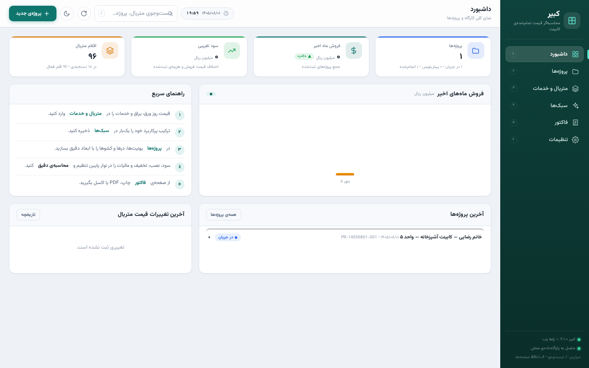
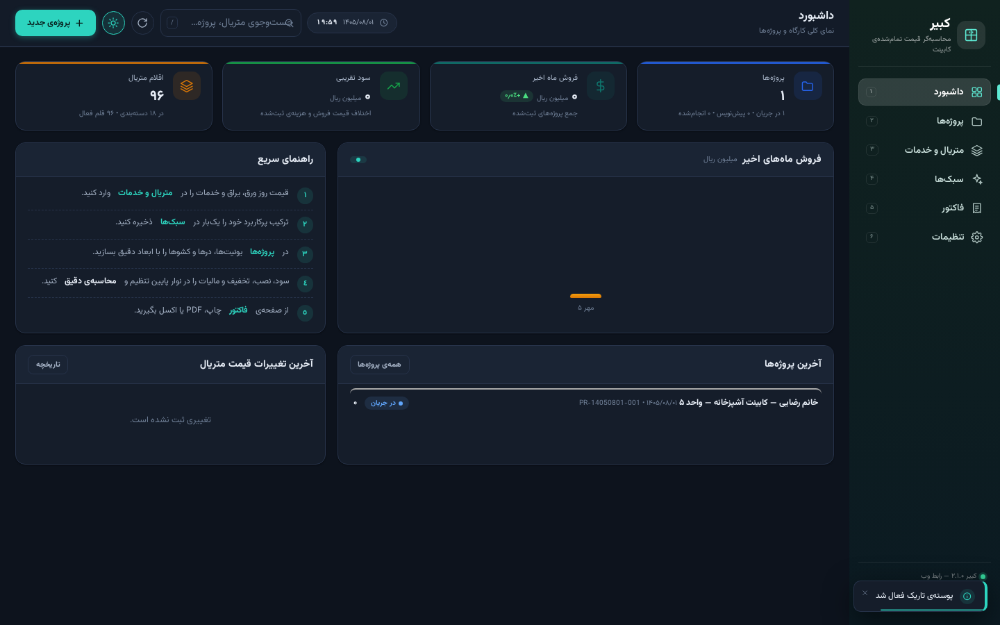
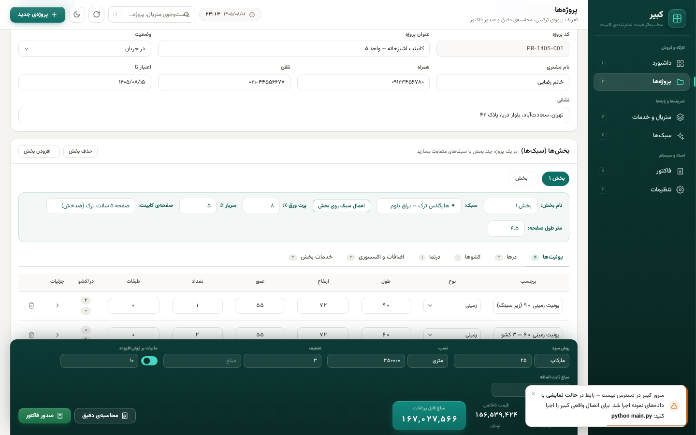
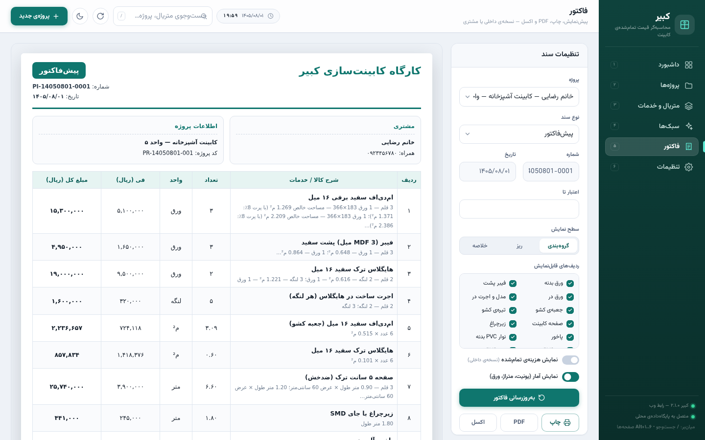

# 📖 آموزش کامل نرم‌افزار کبیر

**کبیر — محاسبه‌گر قیمت تمام‌شده و صدور فاکتور صنعت کابینت**
نسخه‌ی مورد اشاره‌ی این آموزش: **۲٫۱٫۰ (رابط وب)** — آخرین نسخه‌ی مخزن

> این راهنما «کامل» نوشته شده است: از نصب و راه‌اندازی تا تک‌تک دکمه‌های رابط کاربری،
> فرمول‌های محاسبه، خروجی‌ها، پشتیبان‌گیری، حالت نمایشی، میان‌برها، عیب‌یابی و حتی
> بخش توسعه‌دهندگان (API و ساختار کد). اگر وقت کمی دارید، فقط
> [بخش ۵ — شروع سریع](#۵-شروع-سریع-در-پنج-گام) را بخوانید؛ بقیه‌ی بخش‌ها مرجع کامل‌اند.

---

## فهرست مطالب

1. [کبیر چیست و چرا متفاوت است؟](#۱-کبیر-چیست-و-چرا-متفاوت-است)
2. [مفاهیم و واژه‌نامه](#۲-مفاهیم-و-واژه‌نامه)
3. [نصب](#۳-نصب)
4. [اجرا و گزینه‌های راه‌اندازی](#۴-اجرا-و-گزینه‌های-راه‌اندازی)
5. [شروع سریع در پنج گام](#۵-شروع-سریع-در-پنج-گام)
6. [آشنایی با محیط برنامه](#۶-آشنایی-با-محیط-برنامه)
7. [داشبورد](#۷-داشبورد)
8. [صفحه‌ی متریال و خدمات](#۸-صفحه‌ی-متریال-و-خدمات)
9. [صفحه‌ی سبک‌ها](#۹-صفحه‌ی-سبک‌ها)
10. [صفحه‌ی پروژه‌ها (ویرایشگر پروژه)](#۱۰-صفحه‌ی-پروژه‌ها-ویرایشگر-پروژه)
11. [فرمول‌های محاسبه (موتور قیمت تمام‌شده)](#۱۱-فرمول‌های-محاسبه-موتور-قیمت-تمام‌شده)
12. [صفحه‌ی فاکتور و بایگانی](#۱۲-صفحه‌ی-فاکتور-و-بایگانی)
13. [صفحه‌ی تنظیمات](#۱۳-صفحه‌ی-تنظیمات)
14. [پشتیبان‌گیری، بازیابی و انتقال داده‌ها](#۱۴-پشتیبان‌گیری-بازیابی-و-انتقال-داده‌ها)
15. [حالت نمایشی (دمو) و نسخه‌ی تک‌فایلی](#۱۵-حالت-نمایشی-دمو-و-نسخه‌ی-تک‌فایلی)
16. [میان‌برها و نکات قدرت‌کاربر](#۱۶-میان‌برها-و-نکات-قدرت‌کاربر)
17. [عیب‌یابی و پرسش‌های پرتکرار](#۱۷-عیب‌یابی-و-پرسش‌های-پرتکرار)
18. [امنیت و حریم خصوصی](#۱۸-امنیت-و-حریم-خصوصی)
19. [راهنمای توسعه‌دهندگان](#۱۹-راهنمای-توسعه‌دهندگان)
20. [مرجع سریع (Cheat-Sheet)](#۲۰-مرجع-سریع-cheat-sheet)
21. [سناریوهای کاربردی روزمره](#۲۱-سناریوهای-کاربردی-روزمره)

---

## ۱. کبیر چیست و چرا متفاوت است؟

کبیر یک نرم‌افزار **رومیزی‑تحت‌وب و کاملاً محلی** برای کارگاه‌ها و فروشگاه‌های کابینت‌سازی است که
فرآیند قیمت‌دهی را از «حدس و تجربه» به «محاسبه‌ی قابل‌دفاع» تبدیل می‌کند:

1. ابتدا **هزینه‌ی واقعی** مواد و خدمات از روی ابعاد دقیق یونیت‌ها محاسبه می‌شود
   (مساحت ورق، تعداد ورق با احتساب پرت، متراژ نوار PVC، تعداد لولا/گازور/خار/پایه و…)؛
2. سپس سربار، سود، نصب، تخفیف و مالیات اعمال می‌شود؛
3. و در نهایت **پیش‌فاکتور / فاکتور حرفه‌ای** با خروجی چاپ، PDF و اکسل صادر می‌شود.

### ویژگی‌های کلیدی

| ویژگی | توضیح |
| --- | --- |
| کاملاً فارسی و راست‌به‌چپ | تمام رابط کاربری، اعداد فارسی، تاریخ شمسی، و حتی «مبلغ به حروف» در فاکتور |
| بدون اینترنت و بدون سرور خارجی | همه‌چیز روی سیستم خودتان؛ پایگاه‌داده‌ی SQLite محلی |
| رابط وب داخلی | یک سرویس‌دهنده‌ی سبک پایتون (فقط کتابخانه‌ی استاندارد) رابط HTML/CSS/JS را روی `http://localhost:8080` سرو می‌کند؛ بدون فریم‌ورک، بدون npm |
| چندسکویی | ویندوز، لینوکس و مک |
| فونت وزیرمتن همراه برنامه | برای رابط وب و خروجی PDF؛ نیازی به دانلود نیست |
| پروژه‌ی ترکیبی | چند «بخش» با سبک‌های متفاوت در یک پروژه (مثلاً آشپزخانه هایگلاس + اتاق خواب ملامینه) |
| موتور محاسبه‌ی شفاف | هر ردیف هزینه با فرمول و جزئیات قابل مشاهده است («محاسبه‌ی دقیق») |
| سبک‌های آماده | تا ۲۰ سبک؛ ترکیب متریال پرکاربرد را یک‌بار ذخیره و با یک کلیک فراخوانی کنید |
| تاریخچه‌ی قیمت | هر تغییر قیمت (دستی یا دسته‌جمعی) با دلیل ثبت می‌شود |
| پشتیبان‌گیری خودکار روزانه | + بازیابی امن + خروجی/ورودی JSON برای انتقال بین سیستم‌ها |
| خروجی‌های حرفه‌ای | چاپ از مرورگر، PDF راست‌به‌چپ (ReportLab)، اکسل (openpyxl) |
| حالت نمایشی (دمو) | اگر سرور در دسترس نباشد، رابط با داده‌های نمونه و موتور محاسباتی جاوااسکریپتی کار می‌کند |
| PWA | قابلیت نصب از مرورگر (مانیفست + آیکون‌ها) |

### معماری در یک نگاه

```
مرورگر شما (رابط وب فارسی، پوشه‌ی webui/)
        │  HTTP (JSON API)
        ▼
سرویس‌دهنده‌ی محلی کبیر (kabir/web/server.py — فقط کتابخانه‌ی استاندارد پایتون)
        │
        ├── موتور محاسبه (kabir/core/costing.py)   ← قلب نرم‌افزار
        ├── سازنده‌ی فاکتور (invoice.py / invoice_pdf.py / exporters.py)
        └── پایگاه‌داده‌ی SQLite (kabir.db) + پشتیبان‌ها + خروجی‌ها
```

> 📌 **نکته درباره‌ی نسخه‌ها:** نسخه‌های قدیمی‌تر کبیر رابط رومیزی PyQt داشتند.
> از نسخه‌ی ۲٫۱٫۰ نقطه‌ی ورود اصلی (`main.py`) **رابط وب** است و پوشه‌ی `kabir/ui`
> صرفاً بقایای نسخه‌ی رومیزی است و در اجرای فعلی استفاده نمی‌شود. این آموزش بر اساس
> همین نسخه‌ی وب نوشته شده است.

---

## ۲. مفاهیم و واژه‌نامه

قبل از هر چیز این واژه‌ها را بشناسید؛ در تمام راهنما استفاده می‌شوند:

| مفهوم | معنی در کبیر |
| --- | --- |
| **یونیت (Unit)** | یک بدنه‌ی کابینت با ابعاد مشخص (طول×ارتفاع×عمق). انواع رایج در رابط کاربری: **زمینی**، **دیواری**، **کمد ایستاده** |
| **لنگه‌ی در (Door)** | یک ردیف در متعلق به یک یونیت، با عرض/ارتفاع/مدل/لولا/دستگیره/مونتاژ/بسته‌بندی |
| **کشو (Drawer)** | یک ردیف کشو متعلق به یک یونیت، با ریل/ورق جعبه/تیره/دستگیره |
| **بخش (Page/Section)** | زیرمجموعه‌ی یک پروژه با یک «سبک» مشخص. پروژه‌ی ترکیبی = چند بخش |
| **سبک (Style)** | ترکیب آماده‌ی متریال (ورق بدنه، ورق در، فیبر، نوار، لولا، دستگیره، صفحه، تاج، …) + پرت و سربار پیش‌فرض |
| **پرت ورق (Waste %)** | درصدی از مساحت که بابت بریدگی‌های غیرقابل استفاده اضافه می‌شود (پیش‌فرض ۱۰٪؛ در سبک‌ها قابل تغییر) |
| **سربار (Overhead %)** | درصدی که روی جمع هزینه‌های بخش بابت اجاره/برق/استهلاک کارگاه اضافه می‌شود |
| **درنما (Facade)** | روکش نمای بیرونی (مثلاً روکش چوب طبیعی روی بدنه)؛ به دو حالت «ریز» یا «متراژ کلی» |
| **اضافات (Extras)** | اقلام جانبی مثل نورپردازی، آبچکان، سطل ریلی — با تعداد/واحد/فی دلخواه |
| **خدمات (Services)** | هزینه‌های کار/اجرت (برش CNC، مونتاژ، حمل، طراحی…) با «مبنای» محاسبه‌ی خودکار |
| **مارکاپ (Markup)** | سود به‌صورت درصدی **از هزینه**: فروش = هزینه × (۱ + درصد/۱۰۰) |
| **مارجین (Margin)** | سود به‌صورت درصدی **از قیمت فروش**: فروش = هزینه ÷ (۱ − درصد/۱۰۰) |
| **نصب** | هزینه‌ی نصب به سه روش: مبلغ ثابت / متری (× متر طول یونیت‌های زمینی و کمد) / درصدی |
| **مبلغ ثابت اضافه** | مبلغی کلی در سطح پروژه (مثلاً بابت تفاوت قیمت نوع درِ بخش‌ها) |
| **نسخه‌ی داخلی / مشتری** | فاکتور با یا بدون ستون «هزینه‌ی تمام‌شده»؛ نسخه‌ی حاوی هزینه فقط برای خودتان |
| **کد پروژه** | شناسه‌ی خودکار پروژه به شکل `PR-14050801-001` (تاریخ شمسی + شماره‌ی ترتیبی) |
| **شماره‌ی فاکتور** | شناسه‌ی خودکار به شکل `PI-14050801-0001` (پیش‌فاکتور) یا `INV-…` (فاکتور فروش/رسمی) |

---

## ۳. نصب

### ۳٫۱ پیش‌نیازها

| مورد | حداقل | توضیح |
| --- | --- | --- |
| پایتون | **۳٫۱۰ یا بالاتر** | از [python.org](https://www.python.org/downloads/) — در نصب ویندوز حتماً تیک **Add Python to PATH** را بزنید |
| مرورگر | هر مرورگر مدرن (کروم/اج/فایرفاکس/سافاری) | رابط کاربری داخل مرورگر باز می‌شود |
| اینترنت | **لازم نیست** | فونت وزیرمتن همراه خود برنامه است؛ فقط اگر بخواهید می‌توانید بدون اینترنت هم کار کنید |

هسته‌ی نرم‌افزار (سرویس‌دهنده‌ی وب، پایگاه‌داده، موتور محاسبه) **فقط به کتابخانه‌ی استاندارد
پایتون** نیاز دارد. وابستگی‌های `requirements.txt` برای خروجی‌های PDF و اکسل‌اند:

| کتابخانه | کاربرد | اگر نصب نباشد چه می‌شود؟ |
| --- | --- | --- |
| `reportlab` | ساخت PDF فاکتور | دکمه‌ی PDF خطا می‌دهد؛ بقیه‌ی برنامه سالم است |
| `arabic-reshaper` + `python-bidi` | شکل‌دهی و راست‌به‌چپ کردن متن فارسی در PDF | PDF خراب یا چپ‌چین می‌شود؛ بقیه‌ی برنامه سالم است |
| `openpyxl` | خروجی اکسل (فاکتور و لیست متریال) | دکمه‌های اکسل خطا می‌دهند؛ بقیه‌ی برنامه سالم است |

> وضعیت این وابستگی‌ها را هر لحظه می‌توانید با `GET /api/health` (فیلد `missing_deps`) ببینید؛
> در شروع سرور هم اگر چیزی کم باشد روی کنسول هشدار چاپ می‌شود.

### ۳٫۲ دریافت کد

```bash
git clone https://github.com/erfanjaster/kabir_app.git
cd kabir_app
```

(یا از صفحه‌ی مخزن دکمه‌ی **Code → Download ZIP** را بزنید و استخراج کنید.)

### ۳٫۳ نصب وابستگی‌ها

**ویندوز:**

```bat
install.bat
```

**لینوکس / مک:**

```bash
./install.sh
```

**دستی (همه‌ی سیستم‌عامل‌ها):**

```bash
pip install -r requirements.txt
```

> در ویندوز اگر `pip` شناخته نشد: `python -m pip install -r requirements.txt`
> یا `py -3 -m pip install -r requirements.txt`.
> در لینوکس/مک ممکن است `pip3` لازم باشد.

### ۳٫۴ نصب به‌صورت پکیج (اختیاری، برای توسعه‌دهندگان)

```bash
pip install -e .
```

پس از آن دستور `kabir` روی ترمینال در دسترس است (معادل `python main.py`).

### ۳٫۵ اولین اجرا چه اتفاقی می‌افتد؟

1. پوشه‌ی داده ساخته می‌شود (جدول بخش ۳٫۶).
2. پایگاه‌داده‌ی `kabir.db` با جدول‌ها ساخته می‌شود.
3. **داده‌ی نمونه‌ی صنعت کابینت درج می‌شود:** ۱۸ دسته‌بندی، **۹۶ قلم متریال/خدمت** و **۵ سبک آماده**
   (هایگلاس اقتصادی، هایگلاس لوکس یراق ترک، ممبران کلاسیک، پلی‌اورتان رنگی، ملامینه کارگاهی).
4. یک **پشتیبان خودکار روزانه** ساخته می‌شود.
5. سرویس‌دهنده بالا می‌آید و مرورگر روی `http://localhost:8080` باز می‌شود.

> ⚠️ قیمت‌های نمونه فقط برای راه‌اندازی سریع‌اند؛ **حتماً** نرخ‌های روز بازار خودتان را
> در صفحه‌ی «متریال و خدمات» وارد کنید (بخش ۸).

### ۳٫۶ داده‌های من کجا ذخیره می‌شوند؟

| سیستم‌عامل | مسیر |
| --- | --- |
| ویندوز | `%APPDATA%\KabirCabinet` |
| لینوکس | `~/.local/share/KabirCabinet` (یا `$XDG_DATA_HOME`) |
| مک | `~/Library/Application Support/KabirCabinet` |

داخل این پوشه:

```
KabirCabinet/
├── kabir.db          ← کل داده‌های شما (متریال، سبک‌ها، پروژه‌ها، فاکتورها، تنظیمات)
├── kabir.log         ← لاگ خطاهای غیرمنتظره (برای گزارش خرابی)
├── backups/          ← فایل‌های پشتیبان (kabir-auto-… / kabir-web-… / …)
├── exports/          ← خروجی‌های PDF/اکسل/JSON که سرور می‌سازد
└── fonts/            ← کش فونت (در صورت نیاز)
```

> 🔧 **نسخه‌ی قابل‌حمل (Portable):** اگر متغیر محیطی `KABIR_DATA_DIR` را تنظیم کنید،
> تمام داده‌ها در همان مسیر ذخیره می‌شوند؛ مثلاً روی یک فلش یا کنار خود برنامه:
>
> ```bash
> # لینوکس/مک
> KABIR_DATA_DIR=./data python main.py
> # ویندوز (CMD)
> set KABIR_DATA_DIR=D:\KabirData && python main.py
> ```

### ۳٫۵ به‌روزرسانی به نسخه‌ی جدید (بدون از دست رفتن داده‌ها)

چون همه‌ی داده‌های شما در مسیر داده‌ی کاربر (جدول بالا) نگه داشته می‌شوند — نه داخل پوشه‌ی
برنامه — به‌روزرسانی کد هرگز پروژه‌ها، متریال‌ها، فاکتورها یا تنظیمات شما را پاک نمی‌کند.
برای به‌روزرسانی کافی است اسکریپت مخصوص سیستم‌عامل خود را اجرا کنید:

| سیستم‌عامل | اسکریپت به‌روزرسانی |
| --- | --- |
| ویندوز | `update.bat` (دوبار کلیک) |
| لینوکس | `./update.sh` |
| مک | `update.command` (دوبار کلیک در Finder) یا `./update.sh` |

> 📩 این اسکریپت‌ها **خودبسنده (standalone)** هستند: اگر کارگاهی نسخه‌ی قدیمی دارد،
> کافی است فقط فایل `update.bat` را برایش بفرستید؛ حتی اگر کنار پوشه‌ی برنامه نباشد،
> پوشه‌ی کبیر را پیدا می‌کند (یا از کاربر می‌پرسد، یا نصب تازه می‌سازد)، هسته‌ی
> به‌روزرسان را از گیت‌هاب می‌گیرد و کل به‌روزرسانی را انجام می‌دهد.

مراحل خودکار:

1. **گرفتن نسخه‌ی جدید**: اگر پوشه کلونِ گیت باشد با `git pull`؛ وگرنه (مثلاً نصب ZIP)
   **دانلود ZIP مخزن از گیت‌هاب** و جایگزینی فایل‌ها — بدون حذف فایل‌های شخصی کاربر؛
2. به‌روزرسانی وابستگی‌های `requirements.txt`؛
3. **پشتیبان‌گیری از پایگاه‌داده پیش از هر تغییری** (`backups/kabir-pre-update-…`)؛
4. مهاجرت طرح پایگاه‌داده به‌صورت امن و گام‌به‌گام (داده‌ها دست‌نخورده می‌مانند)؛
5. بازمحاسبه‌ی قیمت همه‌ی پروژه‌ها با نرخ‌های جاری متریال.

گزینه‌های پیشرفته: `python update.py --help` — با `--app-dir` پوشه‌ی برنامه را مشخص کنید،
با `--force-zip` حتی در کلون گیت هم از ZIP استفاده می‌شود، با `--no-fetch` کد دانلود
نمی‌شود (فقط وابستگی/مهاجرت)، با `--skip-deps` وابستگی‌ها نصب نمی‌شوند، با `--no-backup`
پشتیبان گرفته نمی‌شود و با `--no-recalc` بازمحاسبه انجام نمی‌شود. مهاجرت تنها هم
قابل اجراست: `python -m kabir.data.migrate`.

> 💡 پس از به‌روزرسانی از نسخه‌های قدیمی‌تر، پروژه‌هایی که مبلغشان با نرخ‌های قدیمی ذخیره شده
> در صفحه‌ی «پروژه‌ها» نشان «نرخ قدیمی» می‌گیرند و بنری زرد بالای فهرست ظاهر می‌شود؛
> با دکمه‌ی «بازمحاسبه‌ی همه‌ی پروژه‌ها» همه‌ی مبلغ‌ها یک‌جا با نرخ روز به‌روز می‌شوند.
> (از این نسخه به بعد، هر تغییر قیمت متریال — تکی یا دسته‌جمعی — همه‌ی پروژه‌ها را
> **خودکار** با نرخ جدید بازمحاسبه می‌کند، بنابراین معمولاً نیازی به این کار نخواهد بود.)

---

## ۴. اجرا و گزینه‌های راه‌اندازی

### ۴٫۱ اجرای عادی

**ویندوز:** `run.bat` را دوبار کلیک کنید.
**لینوکس / مک:** `./run.sh`
**دستی:**

```bash
python main.py
```

خروجی کنسول:

```
   ╔═══════════════════════════════════════════════════════════╗
   ║   🗄  کـبـیـر  —  قیمت تمام‌شده و فاکتور صنعت کابینت       ║
   ╚═══════════════════════════════════════════════════════════╝
  نسخه: ۲٫۱٫۰
  نشانی: http://localhost:8080/
  پایگاه‌داده: /…/KabirCabinet/kabir.db
  پوشه‌ی رابط وب: /…/webui
  برای توقف: Ctrl+C
```

پس از حدود یک ثانیه مرورگر به‌صورت خودکار باز می‌شود. برای توقف سرور در کنسول
`Ctrl+C` بزنید.

> فایل‌های `web.py` و `run-web.bat` / `run-web.sh` هم دقیقاً همین سرور را اجرا می‌کنند
> (برای سازگاری با عادت‌های نسخه‌های قبل نگه داشته شده‌اند).

### ۴٫۲ گزینه‌های خط فرمان

```bash
python main.py [--host HOST] [--port PORT] [--no-browser] [--quiet] [--version]
```

| گزینه | پیش‌فرض | کاربرد |
| --- | --- | --- |
| `--port` | `8080` (یا متغیر `KABIR_WEB_PORT`) | پورت دلخواه؛ مثلاً `--port 9000` |
| `--host` | `127.0.0.1` (یا متغیر `KABIR_WEB_HOST`) | نشانی میزبان؛ `0.0.0.0` یعنی دسترسی از شبکه‌ی محلی |
| `--no-browser` | — | مرورگر خودکار باز نشود |
| `--quiet` | — | بدون پیام‌های راه‌اندازی روی کنسول |
| `--version` | — | چاپ نسخه و خروج |

### ۴٫۳ متغیرهای محیطی

| متغیر | کاربرد |
| --- | --- |
| `KABIR_DATA_DIR` | جایگزینی مسیر داده‌ها (نسخه‌ی قابل‌حمل) |
| `KABIR_WEB_HOST` | مقدار پیش‌فرض `--host` |
| `KABIR_WEB_PORT` | مقدار پیش‌فرض `--port` |
| `KABIR_WEB_LOG` | اگر تنظیم شود، درخواست‌های HTTP روی کنسول لاگ می‌شوند (دیباگ) |

### ۴٫۴ اگر پورت اشغال باشد؟

- اگر پورت ۸۰۸۰ توسط **خود کبیر** اشغال باشد: پیام «کبیر از قبل در حال اجراست» چاپ و فقط مرورگر باز می‌شود (نمونه‌ی دوم بالا نمی‌آید).
- اگر برنامه‌ی **دیگری** پورت را گرفته باشد: کبیر به‌صورت خودکار اولین پورت آزاد در بازه‌ی `port+1 … port+20` را انتخاب و اطلاع می‌دهد.

### ۴٫۵ دسترسی از دستگاه‌های دیگر (شبکه‌ی محلی)

```bash
python main.py --host 0.0.0.0
```

سپس از موبایل/لپ‌تاپ دیگر در همان شبکه: `http://<آی‌پی-سیستم-شما>:8080`
(رابط وب واکنش‌گراست و روی موبایل نوار کناری کشویی دارد؛ قابل نصب به‌صورت PWA هم هست.)

> ⚠️ **هشدار امنیتی:** کبیر سیستم احراز هویت ندارد (نرم‌افزار تک‌کاربره‌ی محلی است).
> فقط روی شبکه‌ی قابل اعتماد باز کنید و هرگز روی اینترنت عمومی منتشر نکنید.

---

## ۵. شروع سریع در پنج گام

این مسیرِ روزمره‌ی کار با کبیر است (همان «راهنمای سریع» داخل داشبورد):

| گام | صفحه | کار |
| --- | --- | --- |
| ۱ | **متریال و خدمات** | قیمت روز ورق، فیبر، در، تاج، زیرچراغ، پاخور، صفحه، نوار، لولا، گازور، خار، دستگیره، پایه، ریل و خدمات را وارد/اصلاح کنید. برای به‌روزرسانی سریع نرخ بازار از «تغییر دسته‌جمعی قیمت» استفاده کنید؛ همه‌ی تغییرات در «تاریخچه‌ی قیمت» ثبت می‌شوند. |
| ۲ | **سبک‌ها** | ترکیب متریال پرکاربردتان را یک‌بار ذخیره کنید (تا ۲۰ سبک) تا در هر پروژه با یک کلیک فراخوانی شود. |
| ۳ | **پروژه‌ها** | پروژه بسازید؛ برای هر بخش، یونیت‌ها را با ابعاد دقیق (طول/ارتفاع/عمق/تعداد/طبقات) وارد کنید؛ درها و کشوها را تعریف کنید؛ درنما، اضافات و خدمات بخش را اضافه کنید. |
| ۴ | **نوار پایین ویرایشگر** | روش سود (مارکاپ/مارجین)، نصب (ثابت/متری/درصدی)، تخفیف و مالیات را تنظیم کنید؛ «محاسبه‌ی دقیق» ریز هزینه‌ها را نشان می‌دهد. |
| ۵ | **فاکتور** | سطح نمایش (گروه‌بندی/ریز/خلاصه) و ردیف‌های قابل‌نمایش را انتخاب کنید، سپس چاپ، PDF یا اکسل بگیرید و در بایگانی ذخیره کنید. |

### یک مثال عددی کامل (برای درک جریان کار)

فرض کنید یک یونیت زمینی ۹۰×۷۲×۵۵ با یک طبقه، دو لنگه‌ی در ۴۵×۷۰ هایگلاس و پایه و خار دارید:

1. در «پروژه‌ها» → «پروژه‌ی جدید» → عنوان: «کابینت آشپزخانه — واحد ۵»، سبک: «هایگلاس لوکس».
2. در ویرایشگر، تب «یونیت‌ها» → «＋ افزودن یونیت» → طول ۹۰، ارتفاع ۷۲، عمق ۵۵، تعداد ۱، طبقات ۱.
3. روی فلش «جزئیات» ردیف یونیت کلیک کنید و متریال‌ها (ورق بدنه، فیبر پشت، نوار، صفحه، پایه، خار، مونتاژ) را انتخاب کنید (اگر سبک اعمال شده باشد، خودش پر می‌شود).
4. تب «درها» → «＋ افزودن در» → لنگه ۲، عرض ۴۵، ارتفاع ۷۰، ورق در هایگلاس، مدل/اجرت، لولا، دستگیره.
5. نوار پایین: سود مارکاپ ۳۰٪، نصب متری ۳۵۰٬۰۰۰ تومان، مالیات روشن ۱۰٪ → اعداد پایین همان لحظه به‌روز می‌شوند.
6. «محاسبه‌ی دقیق» را بزنید: جدول گروه‌ها (ورق بدنه، ورق در، لولا، …) + جمع هزینه + سود + مبلغ قابل پرداخت + آمار فنی (چند ورق، چند متر نوار، چند لنگه…).
7. «صدور فاکتور» → صفحه‌ی فاکتور باز می‌شود؛ سطح «گروه‌بندی»، بدون ستون هزینه → «چاپ» یا «PDF» → «ذخیره در بایگانی».

تمام اعداد این مثال با فرمول‌های بخش ۱۱ محاسبه می‌شوند؛ هیچ عددی حدسی نیست.

---

## ۶. آشنایی با محیط برنامه



### ۶٫۱ اسپلش (Splash)

هنگام راه‌اندازی یک اسپلش برنددار با نوار پیشرفت و پیام‌های مرحله‌به‌مرحله
(«اتصال به پایگاه‌داده‌ی محلی…»، «آماده‌سازی رابط کاربری…») می‌بینید؛ پس از آماده‌شدن، محو می‌شود.

### ۶٫۲ نوار کناری (Sidebar)

شش صفحه با شماره‌ی میان‌بر:

| # | صفحه | کاربرد |
| --- | --- | --- |
| ۱ | داشبورد | نمای کلی: آمار، نمودار فروش، آخرین پروژه‌ها و تغییرات قیمت |
| ۲ | پروژه‌ها | فهرست پروژه‌ها + ویرایشگر کامل پروژه |
| ۳ | متریال و خدمات | کتابخانه‌ی قیمت‌ها + تاریخچه + تغییر دسته‌جمعی |
| ۴ | سبک‌ها | ترکیب‌های آماده‌ی متریال |
| ۵ | فاکتور | صدور/چاپ/PDF/اکسل + بایگانی فاکتورها |
| ۶ | تنظیمات | اطلاعات فروشگاه، پیش‌فرض‌ها، پول/مالیات/نمایش، پشتیبان‌گیری |

پایین نوار کناری: **نشانگر نسخه** و **نشانگر اتصال**:

- 🟢 «متصل به پایگاه‌داده‌ی محلی» → داده‌ها واقعی و در `kabir.db` ذخیره می‌شوند.
- 🟠 «حالت نمایشی» → سرور در دسترس نیست؛ داده‌ها فقط در مرورگرند (بخش ۱۵).

### ۶٫۳ نوار بالا (Topbar)

- **عنوان و زیرعنوان صفحه‌ی فعلی**
- **ساعت و تاریخ شمسی** زنده (تراشه‌ی ساعت)
- **جست‌وجوی سراسری** (با کلید `/`): میان متریال‌ها و پروژه‌ها جست‌وجو می‌کند و با انتخاب نتیجه، مستقیم به صفحه/پروژه می‌رود
- **دکمه‌ی به‌روزرسانی** ↻: داده‌ها را دوباره از پایگاه‌داده می‌خواند (اگر اتصال قطع شده باشد، تلاش برای اتصال مجدد)
- **دکمه‌ی پوسته** ☀/🌙: روشن/تاریک (در مرورگر شما ذخیره می‌شود و در تنظیمات هم قابل ذخیره است)
- **دکمه‌ی «پروژه‌ی جدید»**: از هر جای برنامه می‌توانید سریع پروژه بسازید

### ۶٫۴ بنر حالت نمایشی

اگر سرور قطع شود، بنر زرد بالای صفحه با دکمه‌ی «اتصال به سرور» ظاهر می‌شود.
کبیر هر **۲۰ ثانیه** سلامت سرور را بررسی می‌کند و در صورت برگشت سرور، خودکار وصل و داده‌ها را بازخوانی می‌کند.

### ۶٫۵ اجزای مشترک رابط

- **توست‌ها (Toasts):** پیام‌های موفقیت/هشدار/خطا گوشه‌ی صفحه با نوار پیشرفت و دکمه‌ی بستن.
- **مودال‌ها:** پنجره‌های افزودن/ویرایش متریال، تغییر دسته‌جمعی، سبک، پروژه‌ی جدید، محاسبه‌ی دقیق و تأیید حذف. (با `Esc` یا کلیک روی پس‌زمینه بسته می‌شوند؛ فوکوس داخل مودال به دام می‌افتد.)
- **جدول‌ها:** سرستون **چسبان**؛ با کلیک روی سرستون‌های مرتب‌پذیر ⇅ sorts می‌شود؛ ردیف‌های خالی پیام راهنما دارند.
- **اسکلتون/اسپینر:** روی دکمه‌ها هنگام عملیات ناهمزمان نمایش داده می‌شود.
- **شمارنده‌های متحرک:** اعداد داشبورد با انیمیشن شمارش نمایش داده می‌شوند.
- **واکنش‌گرایی:** در عرض کم، نوار کناری به منوی کشویی (دکمه‌ی ☰) تبدیل می‌شود.
- **دسترس‌پذیری:** `aria-*`، پشتیبانی `prefers-reduced-motion`، کنتراست مناسب در هر دو پوسته.
- **مسیردهی هش:** آدرس صفحه در URL ذخیره می‌شود (`#/projects/3`)؛ می‌توانید لینک یک پروژه را کپی/بوک‌مارک کنید.

---

## ۷. داشبورد



| بخش | محتوا |
| --- | --- |
| کارت **پروژه‌ها** | تعداد کل + تفکیک وضعیت (پیش‌نویس / در جریان / انجام‌شده / لغوشده) |
| کارت **فروش ماه اخیر** | جمع مبلغ نهایی پروژه‌های ماه جاری شمسی + نشانگر رشد نسبت به ماه قبل |
| کارت **سود تقریبی** | جمع (قیمت فروش − هزینه‌ی ثبت‌شده) پروژه‌ها |
| کارت **اقلام متریال** | تعداد اقلام کتابخانه + تعداد اقلام فعال |
| نمودار **فروش ماه‌های اخیر** | میله‌ای شش‌ماهه‌ی شمسی با برچسب واحد پول |
| کارت **راهنمای سریع** | پنج گام شروع (با لینک مستقیم به صفحه‌ها) |
| کارت **آخرین پروژه‌ها** | پنج پروژه‌ی اخیر؛ کلیک = باز شدن ویرایشگر |
| کارت **آخرین تغییرات قیمت متریال** | شش تغییر اخیر قیمت (دکمه‌ی «تاریخچه» = رفتن به تاریخچه‌ی کامل) |

> اعداد داشبورد از پایگاه‌داده محاسبه می‌شوند (نه حدس): فروش ماه از جمع `final_price`
> پروژه‌ها و سود از اختلاف قیمت فروش و هزینه‌ی ثبت‌شده‌ی هر پروژه.

---

## ۸. صفحه‌ی متریال و خدمات

اینجا **کتابخانه‌ی قیمت‌های** شماست؛ همه‌ی محاسبات پروژه‌ها از این اعداد تغذیه می‌شوند.

### ۸٫۱ ساختار صفحه

- **جست‌وجو** (نام/یادداشت/تأمین‌کننده)
- **نشان واحد پول فعلی** (ریال/تومان از تنظیمات)
- **دکمه‌ها:** «تاریخچه‌ی قیمت»، «خروجی اکسل»، «تغییر دسته‌جمعی قیمت»، «افزودن قلم»
- **چیپ‌های دسته‌بندی:** فیلتر سریع روی ۱۸ دسته + «همه»
- **جدول اقلام** با ستون‌های: شناسه، نام (+یادداشت)، دسته‌بندی، مشخصات (ضخامت/ابعاد ورق/عرض مؤثر)، واحد، قیمت، تأمین‌کننده، وضعیت، عملیات (ویرایش/فعال‌سازی/حذف)
- **پانوشت جدول:** «N قلم نمایش داده شد از M»

### ۸٫۲ دسته‌بندی‌ها (۱۸ دسته)

| کلید | عنوان | واحد پیش‌فرض |
| --- | --- | --- |
| `body_sheet` | ورق بدنه | ورق |
| `door_sheet` | ورق در | ورق |
| `back_sheet` | فیبر پشت | ورق |
| `drawer_sheet` | ورق بدنه‌ی کشو | ورق |
| `door_model` | مدل و اجرت در | عدد |
| `countertop` | صفحه کابینت | متر طول |
| `crown` | تاج | متر طول |
| `underlight` | زیرچراغ | متر طول |
| `kickboard` | پاخور | متر طول |
| `banding` | نوار بدنه و در (PVC) | متر طول |
| `hinge` | لولا | عدد |
| `gas_spring` | گازور / جک | عدد |
| `shelf_pin` | خار طبقه | عدد |
| `handle` | دستگیره | عدد |
| `leg` | پایه | عدد |
| `drawer_slide` | ریل کشو | ست |
| `accessory` | سایر اکسسوری | عدد |
| `service` | خدمات | موردی |

### ۸٫۳ واحدها و تبدیل‌های قیمت (مهم!)

| واحد | معنی | نکته‌ی محاسباتی |
| --- | --- | --- |
| ورق (`sheet`) | قیمت هر ورق کامل | با «عرض ورق × ارتفاع ورق» به **قیمت هر م²** تبدیل می‌شود |
| متر مربع (`sqm`) | قیمت هر م² | بدون تبدیل |
| متر طول (`lm`) | قیمت هر متر طول | اگر «عرض مؤثر» داده شود، به م² هم convertible است (برای صفحه/تاج/پاخور) |
| عدد (`piece`) / ست (`set`) / کیلوگرم (`kg`) / موردی (`job`) | قیمت واحد | بدون تبدیل |

> 💡 وقتی قلمی با واحد «ورق» می‌سازید، **حتماً عرض و ارتفاع ورق** را وارد کنید
> (مثلاً ۱۸۳×۳۶۶)؛ موتور محاسبه تعداد ورق مصرفی را از روی آن سقف می‌زند.
> برای اقلام متری مثل صفحه، **عرض مؤثر** (مثلاً ۶۰ سانتی‌متر) را وارد کنید تا
> تبدیل مترطول↔مترمربع درست انجام شود.

### ۸٫۴ افزودن / ویرایش قلم (مودال)

| فیلد | توضیح |
| --- | --- |
| نام قلم | اجباری؛ یکتا بودن توصیه می‌شود (سبک‌ها با نام متریال کار می‌کنند) |
| دسته‌بندی | یکی از ۱۸ دسته |
| واحد | ورق / م² / متر طول / عدد / ست / کیلوگرم / موردی |
| قیمت | اجباری و بزرگ‌تر از صفر |
| ضخامت (میل) | برای ورق‌ها؛ در محاسبه‌ی ابعاد داخلی یونیت (کسر ضخامت دو بدنه از طول کف/طبقات) استفاده می‌شود |
| عرض/ارتفاع ورق | برای واحدهای ورق |
| عرض مؤثر (سانتی‌متر) | برای اقلام متری (صفحه/تاج/پاخور) |
| تأمین‌کننده / یادداشت | اختیاری؛ در جدول و خروجی اکسل نمایش داده می‌شوند |
| فعال | اقلام غیرفعال در انتخاب‌های پروژه/سبک ظاهر نمی‌شوند (اما حذف نمی‌شوند) |

### ۸٫۵ فعال/غیرفعال و حذف

- دکمه‌ی ⏻ وضعیت قلم را بدون حذف تاریخچه عوض می‌کند.
- حذف قلم، **تاریخچه‌ی قیمت آن را هم حذف** می‌کند و تأیید می‌خواهد.

> ⚠️ اگر قلمی در پروژه‌ها استفاده شده باشد، پس از حذف، همه‌ی پروژه‌ها خودکار بازمحاسبه
> می‌شوند و سهم آن قلم از هزینه **صفر** می‌شود (موتور دیگر قیمتی برای آن نمی‌یابد).
> برای اقلامی که در پروژه‌های قدیمی استفاده‌اید، بهتر است به‌جای حذف از **غیرفعال‌سازی**
> استفاده کنید؛ غیرفعال‌سازی هیچ اثری روی محاسبات ندارد و قیمت قلم برای پروژه‌های
> موجود معتبر می‌ماند.

### ۸٫۶ تغییر دسته‌جمعی قیمت (به‌روزرسانی نرخ بازار)

1. دکمه‌ی «تغییر دسته‌جمعی قیمت».
2. دامنه: «همه‌ی اقلام» یا «فقط دسته‌ی انتخاب‌شده» (دسته‌ی فعلی چیپ‌ها).
3. درصد تغییر: عدد دلخواه (مثلاً `10` یا `-5`) یا چیپ‌های آماده‌ی ‎−۱۰٪، −۵٪، +۵٪، +۱۰٪، +۱۵٪، +۲۰٪.
4. دلیل (در تاریخچه ثبت می‌شود؛ پیش‌فرض: «به‌روزرسانی نرخ بازار»).
5. «اعمال تغییر» → قیمت همه‌ی اقلام دامنه ضرب در (۱ ± درصد) می‌شود و برای هر قلم یک رکورد تاریخچه (قیمت قبل/بعد/درصد/دلیل) ثبت می‌گردد.

> 🔄 **بازمحاسبه‌ی خودکار پروژه‌ها (از نسخه‌ی ۲٫۲):** پس از اعمال تغییر — و همچنین پس از
> ویرایش قیمت یک قلم یا حذف آن — نرم‌افزار **همه‌ی پروژه‌ها را خودکار با نرخ‌های جدید
> بازمحاسبه می‌کند** و مبلغ نهایی و هزینه‌ی تمام‌شده‌ی ذخیره‌شده را به‌روز می‌سازد.
> ساختار پروژه‌ها (یونیت‌ها، متریال‌های انتخابی، تخفیف، مالیات و…) دست‌نخورده می‌ماند و
> تعداد پروژه‌های به‌روزشده در پیام موفقیت نشان داده می‌شود.
>
> اگر به هر دلیلی پروژه‌ای با نرخ قدیمی بماند (مثلاً پایگاه‌داده از نسخه‌ی قدیمی مهاجرت شده
> باشد)، در صفحه‌ی «پروژه‌ها» بنر زرد «نرخ قدیمی» + نشان کنار مبلغ همان پروژه ظاهر می‌شود
> و با دکمه‌ی «بازمحاسبه‌ی همه‌ی پروژه‌ها» یک‌جا اصلاح می‌شوند.
>
> ⚠️ توجه: **فاکتورهای بایگانی‌شده منجمداند** و با تغییر نرخ‌ها عوض نمی‌شوند (اسناد صادرشده
> باید همان‌ بمانند که صادر شده‌اند).

### ۸٫۷ تاریخچه‌ی قیمت

جدولی با ستون‌های: تاریخ (شمسی)، قلم، قیمت قبل، قیمت جدید، درصد تغییر، دلیل.
هم از ویرایش دستی قیمت ثبت می‌شود هم از تغییر دسته‌جمعی. داشبورد هم شش تغییر اخیر را نشان می‌دهد.

### ۸٫۸ خروجی اکسل لیست متریال

دکمه‌ی «خروجی اکسل» یک فایل `materials-YYYYMMDD-HHMM.xlsx` با همه‌ی اقلام و دسته‌بندی‌ها
دانلود می‌کند (مناسب قیمت‌گیری از تأمین‌کننده/بایگانی نرخ‌ها).
> در حالت نمایشی (دمو) این دکمه غیرفعال است.

---

## ۹. صفحه‌ی سبک‌ها

**سبک = ترکیب آماده‌ی متریال + پرت و سربار پیش‌فرض.** با سبک، ساخت پروژه از «انتخاب ۱۵ قلم متریال»
به «یک کلیک» کاهش می‌یابد.

### ۹٫۱ امکانات صفحه

- کارت هر سبک: نام، یادداشت، خلاصه‌ی ترکیب، و دکمه‌های **استفاده (پروژه‌ی جدید با این سبک)**، **ویرایش**، **کپی**، **حذف**.
- سقف **۲۰ سبک** (ثابت نرم‌افزار؛ پیام هشدار وقتی پر شود).
- پنج سبک نمونه همراه برنامه: هایگلاس اقتصادی، هایگلاس لوکس (یراق ترک)، ممبران کلاسیک، پلی‌اورتان رنگی، ملامینه کارگاهی.

### ۹٫۲ مودال تعریف/ویرایش سبک

| گروه فیلد | اقلام |
| --- | --- |
| نام و یادداشت | نام سبک (اجباری)، توضیح کوتاه |
| متریال بدنه | ورق بدنه، فیبر پشت، ورق جعبه‌ی کشو |
| متریال در | ورق در، مدل/اجرت در |
| یراق | نوار، لولا، دستگیره، پایه، خار طبقه، ریل کشو |
| اجزای متری | صفحه، تاج، زیرچراغ، پاخور |
| ضرایب | پرت ورق ٪ (پیش‌فرض ۸)، سربار ٪ (پیش‌فرض ۵) |

فقط اقلامی که انتخاب کنید ذخیره می‌شوند؛ بقیه هنگام اعمال سبک دست‌نخورده می‌مانند.

### ۹٫۳ اعمال سبک کجا اتفاق می‌افتد؟

1. **هنگام ساخت پروژه:** در مودال «پروژه‌ی جدید»، «سبک بخش اول» را انتخاب می‌کنید.
2. **دکمه‌ی «استفاده» روی کارت سبک:** مستقیم مودال پروژه‌ی جدید با آن سبک باز می‌شود.
3. **داخل ویرایشگر پروژه → نوار بخش → «اعمال سبک روی بخش»:** متریال سبک روی
   **همه‌ی یونیت‌ها، درها و کشوهای آن بخش** + پرت و سربار بخش اعمال می‌شود (با تأیید).
   موارد اعمال: ورق بدنه، فیبر پشت، نوار، صفحه، پایه، خار، تاج، زیرچراغ، پاخور، مونتاژ یونیت؛
   برای درها: ورق در، مدل/اجرت، لولا، دستگیره، نوار در، مونتاژ و بسته‌بندی در؛
   برای کشوها: ریل، ورق جعبه، تیره (ورق در)، دستگیره، نوار.

---

## ۱۰. صفحه‌ی پروژه‌ها (ویرایشگر پروژه)

مهم‌ترین صفحه‌ی برنامه. دو ناحیه دارد: **فهرست پروژه‌ها** و **ویرایشگر**.



### ۱۰٫۱ فهرست پروژه‌ها

- **جست‌وجو** روی عنوان/مشتری/کد + **فیلتر وضعیت** (همه/پیش‌نویس/در جریان/انجام‌شده/لغوشده).
- ستون‌ها: کد، عنوان، مشتری، وضعیت (نشان رنگی)، سبک، تاریخ (شمسی)، مبلغ نهایی، عملیات.
- عملیات هر ردیف: 👁 باز کردن ویرایشگر • 🧾 صدور فاکتور مستقیم • 🗑 حذف (با تأیید؛ بخش‌ها و صفحات پروژه هم حذف می‌شوند).
- مرتب‌سازی با کلیک روی سرستون‌های کد/عنوان/مشتری/وضعیت/تاریخ/مبلغ.
- مبلغ نهایی ردیف، همان لحظه با موتور محاسبه به‌روز می‌شود (پروژه‌های لغوشده «—»).

### ۱۰٫۲ ساخت پروژه‌ی جدید

مودال «پروژه‌ی جدید»: **عنوان (اجباری)**، نام مشتری، همراه، **سبک بخش اول**، وضعیت (پیش‌نویس/در جریان).

پس از ایجاد:

- کد خودکار ساخته می‌شود: `PR-<تاریخ شمسی>-<شماره>` مثل `PR-14050801-001` (فقط خواندنی).
- یک **بخش اول** با سبک انتخاب‌شده ساخته می‌شود که پرت/سربار/ضرایب نوار آن از
  تنظیمات پیش‌فرض (و در صورت وجود، از خود سبک) گرفته شده است.
- پیش‌فرض‌های مالی پروژه (روش سود و درصد، نصب، مالیات) از **تنظیمات** خوانده می‌شوند
  (`default_profit_mode` و…) و همیشه قابل تغییر در نوار پایین‌اند.
- ویرایشگر همان لحظه باز می‌شود.

### ۱۰٫۳ کارت «مشخصات پروژه»

| فیلد | توضیح |
| --- | --- |
| کد پروژه | فقط خواندنی |
| عنوان پروژه | آزاد |
| وضعیت | پیش‌نویس / در جریان / انجام‌شده / لغوشده (نشان کنار عنوان کارت هم رنگ می‌شود) |
| نام مشتری / همراه / تلفن / نشانی | در سربرگ فاکتور چاپ می‌شوند |
| اعتبار تا | تاریخ اعتبار پیش‌فاکتور (متن آزاد، مثلاً ۱۴۰۵/۰۸/۱۵) |

دکمه‌ها: **ذخیره‌ی تغییرات** (یا `Ctrl+S`)، **کپی پروژه** (یک کپی کامل با کد جدید و وضعیت پیش‌نویس)، **بستن**.
اگر تغییری ذخیره نشده باشد، دکمه‌ی ذخیره نشانگر «کثیف» می‌گیرد و هنگام بستن مرورگر هشدار می‌گیرید.

### ۱۰٫۴ بخش‌ها (سبک‌ها) — پروژه‌ی ترکیبی

- **قرص‌ها (Pills):** هر بخش یک قرص با نام و دکمه‌ی حذف ×؛ کلیک روی قرص = رفتن به آن بخش.
- **＋ افزودن بخش** / **حذف بخش** (حداقل یک بخش باید بماند؛ حذف با تأیید است).
- **نوار بخش:**

| فیلد | اثر |
| --- | --- |
| نام بخش | روی قرص و در فاکتور/محاسبات |
| سبک | انتخاب سبک برای این بخش |
| اعمال سبک روی بخش | متریال سبک روی همه‌ی ردیف‌های بخش (بخش ۹٫۳) |
| پرت ورق ٪ | در محاسبه‌ی تعداد ورق این بخش |
| سربار ٪ | درصد اضافه روی جمع هزینه‌های این بخش |
| صفحه‌ی کابینت | انتخاب متریال صفحه → روی **همه‌ی یونیت‌های بخش** ست می‌شود |
| متر طول صفحه | ورودی **کلی** متراژ صفحه برای کل بخش (جدا از متراژ یونیت‌ها) |

### ۱۰٫۵ تب «یونیت‌ها»

ستون‌های جدول: برچسب، نوع، طول، ارتفاع، عمق، تعداد، طبقات، نشان‌های در/کشو، **جزئیات (فلش بازشو)**، حذف.

- **نوع یونیت** و اثر آن بر محاسبه:

| نوع | اثر |
| --- | --- |
| زمینی (`ground`) | بدون سقف (صفحه‌ی کابینت جای سقف را می‌گیرد)؛ پاخور و پایه و متر طول نصب دارد |
| دیواری (`wall`) | سقف دارد؛ تاج و زیرچراغ می‌گیرد؛ در متر طول نصب حساب نمی‌شود |
| کمد ایستاده (`tall`) | سقف + یک طبقه‌ی ثابت وسط؛ پاخور/پایه دارد؛ تاج می‌گیرد؛ در متر طول نصب حساب می‌شود |

- **ردیف باز شو (جزئیات یونیت):** انتخاب متریال اختصاصی هر یونیت:
  ورق بدنه، فیبر پشت، نوار PVC، صفحه کابینت، تاج، زیرچراغ، پاخور، پایه، خار طبقه، مونتاژ یونیت
  + **تعداد پایه در یونیت** (پیش‌فرض ۴) + **خار در هر طبقه** (پیش‌فرض ۴)
  + تیک‌های **سقف یونیت** و **کف یونیت** (حذف پنل‌ها در طراحی‌های خاص)
  + نمایش زنده‌ی **مساحت بدنه‌ی این یونیت** (م²، بدون فیبر پشت).
- دکمه‌ی «＋ افزودن یونیت» یک یونیت زمینی ۶۰×۷۲×۵۵ با یک طبقه می‌سازد و اگر بخش سبک داشته باشد، متریال سبک رویش اعمال می‌شود.

### ۱۰٫۶ تب «درها»

ستون‌ها: **یونیت** (با تغییر آن، در به یونیت دیگری منتقل می‌شود)، برچسب، لنگه، عرض، ارتفاع،
ورق در، مدل/اجرت، لولا، دستگیره، مونتاژ، بسته‌بندی، حذف.

- پیش‌فرض هر ردیف در: ۱ لنگه ۴۵×۷۰، ** لولا در هر لنگه**، **۱ دستگیره در هر لنگه**.
- تعداد لنگه × تعداد یونیت در محاسبه ضرب می‌شود.
- مدل/اجرت در برای سبک‌هایی مثل ممبران/پلی‌اورتان/هایگلاس (اجرت ساخت یا CNC یا رنگ) است.
- مونتاژ و بسته‌بندی از دسته‌ی «خدمات» انتخاب می‌شوند و **به ازای هر لنگه** حساب می‌شوند.
- نوار PVC در و گازور/جک در داده‌ی در پشتیبانی می‌شوند (از طریق اعمال سبک یا داده‌ی وارداتی؛ ستون مستقل در جدول وب ندارند).

### ۱۰٫۷ تب «کشوها»

ستون‌ها: یونیت، برچسب، تعداد، عرض، ارتفاع، عمق، ریل، ورق جعبه، تیره‌ی کشو (معمولاً ورق در)، دستگیره، حذف.

- پیش‌فرض: کشو ۶۰×۱۸×۴۵.
- محاسبه‌ی جعبه‌ی کشو: دو بغل + کف + پشت (فرمول بخش ۱۱)؛ تیره جدا؛ نوار لبه‌ی جعبه جدا؛ ریل و دستگیره به ازای هر کشو.

### ۱۰٫۸ تب «درنما»

سه حالت:

| حالت | ورودی | کاربرد |
| --- | --- | --- |
| بدون درنما | — | پیش‌فرض |
| ریز (`detailed`) | جدول ردیف‌ها: عنوان، تعداد، عرض، ارتفاع، قیمت هر م² (مساحت و جمع خودکار حساب می‌شوند) | وقتی روکش چند قطعه با ابعاد مختلف دارد |
| متراژ کلی (`total`) | متراژ کل (م²) + قیمت هر م² | وقتی متراژ را از پیمانکار درنما گرفته‌اید |

### ۱۰٫۹ تب «اضافات و اکسسوری»

ستون‌ها: عنوان، تعداد، واحد (ورق/م²/متر/عدد/ست/کیلو/موردی)، فی، جمع (خودکار)، **تیک «در فاکتور»**، حذف.
تیک «در فاکتور» یعنی این ردیف در خروجی فاکتور **نمایش داده شود یا نه** (هزینه‌اش همیشه در محاسبه هست؛ مثلاً نورپردازی را مشتری می‌بیند اما «قلم متفرقه‌ی داخلی» را نه).

### ۱۰٫۱۰ تب «خدمات بخش»

- **افزودن از کتابخانه‌ی خدمات:** یک select از همه‌ی اقلام دسته‌ی «خدمات» (برش CNC، مونتاژ، حمل، طراحی، بازدید و…)؛ با انتخاب، نرخ قلم پیش‌پر می‌شود.
- جدول: شرح خدمت، **مبنا**، نرخ، حذف.

| مبنا | مقدار خودکار از کجا؟ |
| --- | --- |
| موردی (ثابت) | ۱ × نرخ |
| هر یونیت | تعداد کل یونیت‌های بخش |
| هر لنگه در | تعداد کل لنگه‌های در بخش |
| هر طبقه | تعداد کل طبقات یونیت‌ها |
| هر متر طول | مجموع متر طول یونیت‌های زمینی + دیواری |
| هر م² | *(در نسخه‌ی فعلی مقدار صفر اعمال می‌شود — محدودیت شناخته‌شده؛ از سایر مبناها استفاده کنید)* |
| درصدی از جمع | درصدی از جمع هزینه‌های بخش (پس از جمع اعمال می‌شود) |

### ۱۰٫۱۱ نوار پایین (مالی پروژه) — محاسبه‌ی زنده

| کنترل | گزینه‌ها |
| --- | --- |
| روش سود | مارکاپ / مارجین + درصد |
| نصب | بدون نصب / مبلغ ثابت / متری / درصدی + مقدار |
| تخفیف | درصد **و/یا** مبلغ (هر دو با هم جمع می‌شوند) |
| مالیات بر ارزش افزوده | کلید روشن/خاموش + درصد |
| مبلغ ثابت اضافه | مبلغ کلی سطح پروژه |

و سه عدد زنده: **جمع هزینه‌ی تمام‌شده**، **قیمت ناخالص**، **مبلغ قابل پرداخت** (برجسته).
هر تغییری در هر جای ویرایشگر (ابعاد، متریال، سود، …) پس از چند صد میلی‌ثانیه
یک محاسبه‌ی کامل روی **موتور واقعی پایتون** (`POST /api/calc`) اجرا و این اعداد به‌روز می‌شوند.

### ۱۰٫۱۲ مودال «محاسبه‌ی دقیق»

ریز کامل هزینه‌ها به‌تفکیک گروه (ورق بدنه، فیبر پشت، ورق در، مدل و اجرت در، جعبه‌ی کشو،
تیره‌ی کشو، صفحه، تاج، زیرچراغ، پاخور، نوارها، لولا، گازور، خار، دستگیره، پایه، ریل، درنما،
اضافات، مونتاژ و خدمات، خدمات، نصب و حمل) + ردیف سربار بخش‌ها + جمع‌ها + سود + تخفیف + مالیات +
**مبلغ قابل پرداخت** + نوار **آمار فنی**:
تعداد یونیت، متر زمینی، متر دیواری، تعداد ورق، لنگه در، کشو، مساحت بدنه.
دکمه‌ی «صدور فاکتور از این محاسبه» مستقیم به صفحه‌ی فاکتور می‌رود.

### ۱۰٫۱۳ ذخیره، کپی، حذف

- **ذخیره:** همه‌ی بخش‌ها/یونیت‌ها/درها/کشوها/ردیف‌ها + فیلدهای مالی در پایگاه‌داده نوشته می‌شوند؛
  `final_price` و `total_cost` پروژه هم برای داشبورد/فهرست به‌روز می‌شوند.
- **کپی پروژه:** کل ساختار (همه‌ی بخش‌ها) با کد جدید کپی می‌شود — مناسب پروژه‌های مشابه.
- **حذف:** با تأیید؛ صفحات (بخش‌ها) آبشاری حذف می‌شوند. فاکتورهای بایگانی‌شده‌ی مرتبط حذف نمی‌شوند (فقط ارتباطشان قطع می‌شود).

---

## ۱۱. فرمول‌های محاسبه (موتور قیمت تمام‌شده)

این بخش «قلب» کبیر است؛ همان چیزی که در `kabir/core/costing.py` پیاده‌سازی شده و
آینه‌ی جاوااسکریپتی آن در `webui/js/engine.js` برای حالت نمایشی وجود دارد.

### ۱۱٫۱ نمادها

- `L, H, D` = طول/ارتفاع/عمق یونیت (سانتی‌متر)
- `t` = ضخامت ورق بدنه (سانتی‌متر) = `thickness_mm ÷ 10`
- `w` = پرت ورق بخش (درصد)، `o` = سربار بخش (درصد)
- `A_sheet` = مساحت یک ورق = (عرض ورق ÷ ۱۰۰) × (ارتفاع ورق ÷ ۱۰۰) مترمربع

### ۱۱٫۲ مساحت بدنه‌ی یونیت (پنل‌های استاندارد)

| پنل | فرمول | شرط |
| --- | --- | --- |
| دو بدنه‌ی کناری | `2 × D × H` | همیشه |
| کف یونیت | `(L − 2t) × D` | تیک «کف یونیت» |
| سقف یونیت | `(L − 2t) × D` | تیک «سقف» **و** نوع ≠ زمینی |
| طبقه‌ی ثابت وسط | `(L − 2t) × D` | نوع = کمد ایستاده |
| طبقات داخلی | `n × (L − 2t) × D` | n = تعداد طبقات |
| فیبر پشت | `L × H` | وقتی متریال فیبر انتخاب شده (در مساحت فیبر جمع می‌شود، نه بدنه) |

> اگر کاربر «ریز بدنه» را دستی عوض کرده باشد (custom panels)، همان مقادیر دستی مبنا قرار می‌گیرند.

### ۱۱٫۳ ورق مصرفی

```
تعداد ورق بدنه = سقف( مساحت بدنه × (۱ + w/۱۰۰) × تعداد یونیت ÷ A_sheet )
```

- گرد کردن **به بالا** (ورق نصفه خریدنی نیست!).
- فیبر پشت هم همین‌طور با `A_sheet` فیبر (مثلاً ۱۲۲×۲۴۴).
- ورق در: `سقف( مساحت لنگه‌ها × ۱٫۰۸ ÷ A_sheet )` (۸٪ تلرانس برش در).
- اگر قلمی واحد ورق نداشته باشد (مثلاً م²)، مساحت × قیمت م² محاسبه می‌شود.

### ۱۱٫۴ نوار PVC

```
نوار بدنه = مساحت بدنه × تعداد × ضریب نوار بدنه (پیش‌فرض ۲٫۲) × (۱ + پرت نوار٪/۱۰۰)
نوار در   = محیط لنگه (۲×(عرض+ارتفاع)) × تعداد لنگه × ضریب نوار در (پیش‌فرض ۱)
نوار کشو  = [۲×(۲×(D+h)) + ۲×(w+D) + ۲×(w+h)] × تعداد کشو
```

### ۱۱٫۵ درها و کشوها

```
مساحت در     = تعداد لنگه × عرض × ارتفاع
لولا         = لولا در هر لنگه (پیش‌فرض ۲) × لنگه‌ها
گازور        = گازور در هر لنگه × لنگه‌ها
دستگیره‌ی در = دستگیره در هر لنگه (پیش‌فرض ۱) × لنگه‌ها
جعبه‌ی کشو   = (۲×D×h) + (w×D) + (w×h)      ← دو بغل + کف + پشت
تیره‌ی کشو   = w × h
ریل/دستگیره/مونتاژ کشو = به ازای هر کشو
```

### ۱۱٫۶ اقلام متری و تعدادی

| قلم | فرمول | شرط نوع یونیت |
| --- | --- | --- |
| صفحه کابینت | `L ÷ ۱۰۰ × تعداد` متر (یا ورودی کلی بخش `countertop_lm`) | یونیت‌هایی که صفحه دارند |
| تاج | `L ÷ ۱۰۰ × تعداد` | دیواری / کمد |
| زیرچراغ | `L ÷ ۱۰۰ × تعداد` | دیواری |
| پاخور | `L ÷ ۱۰۰ × تعداد` | زمینی / کمد |
| پایه | `پایه در یونیت × تعداد` | زمینی / کمد |
| خار طبقه | `خار در هر طبقه × طبقات × تعداد` | وقتی طبقه > ۰ |

### ۱۱٫۷ جمع‌بندی بخش (Page)

```
جمع گروه‌ها = متریال + در + یراق + درنما + مونتاژ/خدمات + خدمات بخش + اضافات
سربار بخش   = جمع × o/۱۰۰
هزینه‌ی بخش = جمع + سربار
(خدمات «درصدی از جمع» پس از جمع اضافه و سربار دوباره حساب می‌شود)
```

### ۱۱٫۸ جمع‌بندی پروژه

```
جمع بخش‌ها        = Σ هزینه‌ی بخش‌ها + مبلغ ثابت اضافه
هزینه‌ی نصب       = ثابت | نرخ × متر طول (زمینی+کمد) | درصد × جمع بخش‌ها
هزینه‌ی تمام‌شده  = جمع بخش‌ها + نصب
سود (مارکاپ)     = هزینه × درصد/۱۰۰          → فروش = هزینه × (۱ + درصد/۱۰۰)
سود (مارجین)     = هزینه × درصد/(۱۰۰−درصد)   → فروش = هزینه ÷ (۱ − درصد/۱۰۰)
قیمت ناخالص      = هزینه‌ی تمام‌شده + سود
تخفیف            = ناخالص × درصد/۱۰۰ + مبلغ تخفیف   (سقف: خود ناخالص)
قیمت خالص        = ناخالص − تخفیف
مالیات           = خالص × درصد/۱۰۰
مبلغ قابل پرداخت = خالص + مالیات
سود واقعی پروژه   = مبلغ قابل پرداخت − هزینه‌ی تمام‌شده − مالیات
```

### ۱۱٫۹ مثال عددی مارکاپ در برابر مارجین

هزینه‌ی تمام‌شده = ۱۰۰٬۰۰٬۰۰ ریال، سود ۲۰٪:

| روش | سود | قیمت فروش |
| --- | --- | --- |
| مارکاپ | ۲۰٬۰۰٬۰۰ | ۱۲۰٬۰۰۰٬۰۰۰ |
| مارجین | ۲۵٬۰۰۰٬۰۰۰ | ۱۲۵٬۰۰۰٬۰۰۰ (سود = ۲۰٪ **از فروش**) |

> اگر مشتری/حسابدارتان «سود از فروش» می‌گوید، مارجین انتخاب کنید؛ اگر «سود روی هزینه» می‌گوید، مارکاپ.

### ۱۱٫۱۰ نمایش پول (مقیاس)

اعداد در پایگاه‌داده همیشه با واحد پایه ذخیره می‌شوند؛ در نمایش، بر `currency_scale` تقسیم می‌شوند:
`1` = بدون تبدیل، `10` = تقسیم بر ۱۰ (نمایش تومان وقتی ذخیره ریال است)، `100` = تقسیم بر ۱۰۰.
واحد پول (ریال/تومان) هم کنار اعداد و در فاکتور چاپ می‌شود.

---

## ۱۲. صفحه‌ی فاکتور و بایگانی



### ۱۲٫۱ ستون گزینه‌ها (سمت راست)

| کنترل | توضیح |
| --- | --- |
| پروژه | انتخاب از پروژه‌های **غیر لغوشده** |
| نوع سند | **پیش‌فاکتور** (`quote`) / **پیش‌فاکتور رسمی** (`proforma`) / **فاکتور فروش** (`invoice`) — عنوان سربرگ سند عوض می‌شود |
| شماره | خودکار و فقط خواندنی؛ الگو: `PI-<شمسی>-<ترتیب>` برای پیش‌فاکتور و `INV-…` برای بقیه؛ با تغییر نوع سند شماره‌ی جدید پیشنهاد می‌شود |
| تاریخ | امروز (شمسی)، فقط خواندنی |
| اعتبار تا | قابل ویرایش (از پروژه پیش‌پر می‌شود) |
| سطح نمایش | **گروه‌بندی** (پیش‌فرض، مناسب مشتری) / **ریز** (هر قلم جدا، مناسب بررسی داخلی) / **خلاصه** (فقط جمع گروه‌ها) |
| ردیف‌های قابل‌نمایش | چک‌باکس هر گروه هزینه (مثلاً «مونتاژ و خدمات» را از فاکتور مشتری حذف کنید) |
| نمایش هزینه‌ی تمام‌شده | روشن = **نسخه‌ی داخلی** (ستون هزینه دیده می‌شود)؛ خاموش = نسخه‌ی مشتری |
| نمایش آمار | چیپ‌های آماری پایین سند (یونیت/متراژ/ورق/در/کشو) |

دکمه‌ها: **به‌روزرسانی فاکتور**، **چاپ**، **PDF**، **اکسل**، **ذخیره در بایگانی فاکتورها**.

### ۱۲٫۲ پیش‌نمایش

پیش‌نمایش، HTML واقعیِ موتور فاکتور (`render_html`) داخل یک iframe است — همان چیزی که چاپ می‌شود.
ساختار سند:

1. **سربرگ:** نام فروشگاه + توضیح، و سمت مقابل: نشان نوع سند، شماره، تاریخ/ساعت، کد پروژه.
2. **دو کادر:** «فروشنده» (نام/مدیریت/تلفن/همراه/نشانی/ایمیل/وب) و «خریدار» (نام/تلفن/همراه/نشانی) + عنوان پروژه.
3. **جدول اقلام:** ردیف، شرح کالا/خدمات (+جزئیات ریز زیر هر ردیف)، تعداد، واحد، فی، مبلغ کل — با ردیف‌های سرگروه در حالت گروه‌بندی.
4. **جدول جمع‌ها:** جمع بخش‌ها، نصب، هزینه‌ی تمام‌شده (فقط نسخه‌ی داخلی)، سود (با ذکر روش)، قیمت ناخالص، تخفیف، قیمت خالص، مالیات، **مبلغ قابل پرداخت** (ردیف برجسته).
5. **مبلغ به حروف فارسی** داخل کادر نقطه‌چین.
6. **چیپ‌های آمار** (در صورت فعال بودن).
7. **پانویس** (یادداشت تنظیمات) + **محل امضای فروشنده/خریدار** + عبارت «نرم‌افزار کبیر».

### ۱۲٫۳ خروجی‌ها

| خروجی | جزئیات |
| --- | --- |
| چاپ | دکمه‌ی «چاپ» iframe پیش‌نمایش را چاپ می‌کند (Ctrl+P مرورگر؛ قالب A4 با حاشیه‌ی استاندارد) |
| PDF | راست‌به‌چپ با فونت وزیرمتن (ReportLab + arabic-reshaper + python-bidi)؛ فایل هم در `exports/` ذخیره می‌شود |
| اکسل | شیت اقلام + جمع‌ها (openpyxl، راست‌به‌چپ)؛ هم‌نام شماره‌ی فاکتور |

> خروجی‌ها در حالت نمایشی (دمو) غیرفعال‌اند؛ باید سرور در حال اجرا باشد.

### ۱۲٫۴ بایگانی فاکتورها

جدول پایین صفحه: شماره، نوع، پروژه، مشتری، تاریخ، مبلغ، عملیات
(**مشاهده** = بازسازی پیش‌نمایش دقیق سند ذخیره‌شده، **PDF** = دریافت PDF همان سند، **حذف**).
«ذخیره در بایگانی» یک **نسخه‌ی کامل و غیرقابل تغییر** از داده‌ی فاکتور (اقلام + جمع‌ها + تنظیمات لحظه‌ی صدور)
ذخیره می‌کند؛ بنابراین حتی اگر بعداً قیمت متریال را عوض کنید، فاکتورهای صادرشده دست‌نخورده می‌مانند.

---

## ۱۳. صفحه‌ی تنظیمات

چهار کارت + نوار ذخیره:

### ۱۳٫۱ اطلاعات فروشگاه / شرکت

نام فروشگاه، مدیریت، تلفن، همراه، ایمیل، وب‌سایت، نشانی،
**عنوان سربرگ فاکتور** (مثلاً «پیش‌فاکتور» یا «فاکتور فروش») و **پانویس فاکتور**
(مثلاً «این پیش‌فاکتور تا ۷ روز اعتبار دارد…»)— همه در سربرگ/پانویس سند چاپ می‌شوند.

### ۱۳٫۲ پیش‌فرض‌های محاسبه

| فیلد | پیش‌فرض | اثر |
| --- | --- | --- |
| روش سود | مارکاپ | پیش‌فرض پروژه‌های جدید |
| درصد سود | ۳۰ | پیش‌فرض پروژه‌های جدید |
| سربار ٪ | ۰ | پیش‌فرض بخش‌های جدید |
| پرت ورق ٪ | ۱۰ | پیش‌فرض بخش‌های جدید |
| روش نصب پیش‌فرض | ثابت/متری/درصدی/بدون | پیش‌فرض پروژه‌های جدید |
| مقدار نصب | ۰ | — |
| عرض/ارتفاع ورق استاندارد | ۱۸۳ / ۳۶۶ | مرجع ابعاد ورق |
| عرض/ارتفاع ورق فیبر | ۱۲۲ / ۲۴۴ | مرجع ابعاد فیبر |
| ضریب نوار بدنه | ۲٫۲ | متر نوار به ازای هر م² بدنه |
| ضریب نوار در | ۱ | ضریب محیط در |

**کارت «ابعاد پیش‌فرض یونیت‌ها»** (جدید در ۲٫۲): طول، ارتفاع، عمق و تعداد طبقات پیش‌فرض
برای هر سه نوع یونیت — **زمینی**، **دیواری** و **کمد ایستاده** — به‌صورت جداگانه.
این مقادیر هنگام «افزودن یونیت» (با دکمه‌های ＋ یونیت زمینی / ＋ یونیت دیواری / ＋ کمد ایستاده)
و همچنین **هنگام تغییر نوع یک یونیت موجود** در ویرایشگر پروژه خودکار اعمال می‌شوند
(بدون دست‌کاری کد، فقط با «ذخیره‌ی تنظیمات»). ابعاد اعمال‌شده همیشه بعداً قابل ویرایش‌اند؛
برچسب یونیت هم اگر دستی تغییر نداده باشید، با نوع و طول جدید به‌روز می‌شود
(مثلاً «یونیت دیواری ۶۰» ← «کمد ایستاده ۶۰»).

### ۱۳٫۳ پول، مالیات و نمایش

- **واحد پول:** ریال / تومان (چاپ روی فاکتور و کنار اعداد).
- **مقیاس نمایش:** بدون تبدیل / تقسیم بر ۱۰ / تقسیم بر ۱۰۰.
- **کلید مالیات بر ارزش افزوده (پیش‌فرض)** + **درصد مالیات** (پیش‌فرض ۱۰) → روی پروژه‌های جدید اعمال می‌شود.
- **نمایش اعداد فارسی** (۱۲۳ ↔ ۱۲۳).
- **پوسته:** روشن / تاریک.
- **اندازه‌ی قلم وب:** اسلایدر ۱۲ تا ۱۸ پیکسل (بلافاصله اعمال و ذخیره می‌شود).

### ۱۳٫۴ پشتیبان‌گیری و داده‌ها

- کلید **پشتیبان‌گیری خودکار روزانه** + **تعداد نسخه‌های نگه‌داشتنی** (پیش‌فرض ۳۰).
- دکمه‌های **پشتیبان‌گیری اکنون**، **خروجی JSON**، **ورود JSON**.
- جدول نسخه‌های پشتیبان: نام، تاریخ، حجم، نوع (خودکار/دستی)، عملیات (**بازیابی** / **حذف**).
- یادداشت مسیر پوشه‌ی داده‌ی فعلی (برای پیدا کردن فایل‌ها).
- **بازنشانی پیش‌فرض‌ها:** مقادیر محاسباتی فرم را به حالت اولیه برمی‌گرداند (تا زمانی که «ذخیره‌ی تنظیمات» نزنید ذخیره نمی‌شود).

> ذخیره‌ی تنظیمات با دکمه‌ی شناور پایین صفحه انجام می‌شود و بلافاصله روی همه‌ی صفحه‌ها اثر می‌گذارد.

---

## ۱۴. پشتیبان‌گیری، بازیابی و انتقال داده‌ها

### ۱۴٫۱ پشتیبان‌گیری خودکار

- در **هر راه‌اندازی سرور**، اگر از آخرین پشتیبانِ «امروز» خبری نباشد، یک نسخه‌ی `kabir-auto-<تاریخ>.db` ساخته می‌شود.
- پس از هر پشتیبان‌گیری، نسخه‌های قدیمی‌تر از سقف `backup_keep` حذف می‌شوند.

### ۱۴٫۲ پشتیبان‌گیری دستی

دکمه‌ی «پشتیبان‌گیری اکنون» (تنظیمات) یا API؛ فایل `kabir-web-<زمان>.db` با API امنِ خود SQLite ساخته می‌شود (بدون قفل شدن پایگاه‌داده).

### ۱۴٫۳ بازیابی (ایمن)

«بازیابی» روی هر نسخه: **اول از وضعیت فعلی یک پشتیبان امن (`before-restore`) می‌گیرد**، سپس جایگزین می‌کند.
یعنی بازیابی هرگز داده‌ی فعلی را بدون تور امن از بین نمی‌برد.

### ۱۴٫۴ انتقال بین سیستم‌ها (خروجی/ورودی JSON)

- **خروجی JSON:** کل داده‌ها (تنظیمات + دسته‌ها + متریال + سبک‌ها + پروژه‌ها + بخش‌ها + فاکتورها) در یک فایل `kabir-data-….json`.
- **ورودی JSON:** انتخاب فایل → تأیید «جایگزینی داده‌های فعلی» → ورود؛ قبل از آن خودکار یک پشتیبان گرفته می‌شود.
- مناسب: انتقال به کامپیوتر جدید، همگام‌سازی بین دفتر و کارگاه، آرشیو بلندمدت.

### ۱۴٫۵ جابه‌جایی دستی فایل پایگاه‌داده

می‌توانید کل پوشه‌ی داده (بخش ۳٫۶) یا فقط `kabir.db` (+فایل‌های `-wal` و `-shm` کنارش) را کپی کنید.
ترتیب امن: بستن سرور (Ctrl+C) ← کپی ← جای‌گذاری در مسیر داده‌ی سیستم مقصد ← اجرا.

---

## ۱۵. حالت نمایشی (دمو) و نسخه‌ی تک‌فایلی

### ۱۵٫۱ کی فعال می‌شود؟

اگر رابط وب باز شود ولی سرور کبیر در دسترس نباشد (مثلاً `webui/index.html` را مستقیم باز کنید،
یا سرور قطع شود)، برنامه در **حالت نمایشی** بالا می‌آید:

- بنر زرد بالای صفحه + نشانگر نارنجی نوار کناری.
- داده‌های نمونه‌ی کامل (متریال، سبک‌ها، چند پروژه‌ی نمونه) بارگذاری می‌شوند.
- همه‌ی تغییرات در **localStorage مرورگر** ذخیره می‌شوند (نه در kabir.db).
- هر ۲۰ ثانیه تلاش برای اتصال مجدد؛ به‌محض در دسترس آمدن سرور، داده‌های واقعی جایگزین می‌شوند.

### ۱۵٫۲ چه چیزهایی در دمو کار می‌کنند/نمی‌کنند؟

| امکان | در دمو |
| --- | --- |
| همه‌ی صفحه‌ها، ویرایشگر پروژه، محاسبه‌ی زنده | ✅ (با موتور جاوااسکریپتیِ آینه‌ی موتور پایتون) |
| پیش‌نمایش فاکتور | ✅ (قالب نمایشی داخلی) |
| چاپ | ✅ |
| PDF / اکسل فاکتور / اکسل متریال | ❌ (نیاز به سرور + کتابخانه‌ها) |
| پشتیبان‌گیری / بازیابی / خروجی و ورود JSON | ❌ |
| بایگانی فاکتور | ✅ ولی فقط داخل مرورگر |

### ۱۵٫۳ نسخه‌ی تک‌فایلی

فایل `webui/kabir-ui-standalone.html` یک **کل برنامه در یک فایل** است
(CSS/JS/فونت به‌صورت درون‌خطی): مناسب دمو دادن به مشتری بدون نصب هیچ چیزی.
این فایل با اسکریپت `webui/build_standalone.py` از روی همین منبع ساخته می‌شود:

```bash
python webui/build_standalone.py
```

### ۱۵٫۴ برابری موتور JS و پایتون

برای اطمینان از این‌که اعداد دمو با اعداد واقعی یکی است، تست برابری وجود دارد:

```bash
python3 tests/parity_export.py && node tests/parity_check.js
```

---

## ۱۶. میان‌برها و نکات قدرت‌کاربر

| میان‌بر | کار |
| --- | --- |
| `/` | فوکوس روی جست‌وجوی سراسری |
| `Alt+1` … `Alt+6` | پرش به صفحه‌ی ۱ تا ۶ |
| `Ctrl+S` | ذخیره‌ی پروژه‌ی باز در ویرایشگر |
| `Esc` | بستن مودال / منوی کشویی / نتایج جست‌وجو |
| کلیک روی سرستون | مرتب‌سازی جدول |
| `Ctrl+P` (داخل پیش‌نمایش فاکتور) | چاپ سند |

نکته‌ها:

- **جست‌وجوی سراسری** هم نام متریال می‌یابد هم عنوان/مشتری پروژه؛ انتخاب نتیجه مستقیم صفحه را باز می‌کند.
- **لینک مستقیم پروژه:** آدرس `#/projects/<id>` را کپی کنید تا همکار دقیقاً همان پروژه را باز کند.
- **به‌روزرسانی نرخ‌ها در ابتدای ماه:** تغییر دسته‌جمعی + دلیل «نرخ مهر ماه» → **همه‌ی پروژه‌ها خودکار با نرخ جدید بازمحاسبه می‌شوند** (از نسخه‌ی ۲٫۲)؛ مبلغ نهایی و هزینه‌ی تمام‌شده‌ی ذخیره‌شده فوراً به‌روز می‌شود و فاکتورهای بایگانی‌شده منجمد می‌مانند.
- **فاکتور داخلی بزنید، مشتری نه:** قبل از PDF برای مشتری، تیک «نمایش هزینه‌ی تمام‌شده» را خاموش کنید؛ نسخه‌ی داخلی را جدا ذخیره کنید.
- **پروژه‌ی لغوشده** در فهرست فاکتور ظاهر نمی‌شود و در آمار فروش حساب نمی‌شود.
- پوسته‌ی تاریک برای کار شب کارگاه راحت‌تر است؛ تنظیمات → پوسته یا دکمه‌ی ☾ بالای صفحه.

---

## ۱۷. عیب‌یابی و پرسش‌های پرتکرار

| مشکل | علت/راه‌حل |
| --- | --- |
| مرورگر باز نشد | دستی به `http://localhost:8080` بروید؛ یا با `--no-browser` اجرا کرده‌اید |
| «پورت اشغال بود» | کبیر خودکار پورت بعدی را گرفته؛ شماره‌ی پورت روی کنسول چاپ شده است |
| `python: command not found` | پایتون نصب نیست یا در PATH نیست؛ در ویندوز `py -3 main.py` را امتحان کنید |
| دکمه‌ی PDF/اکسل خطا می‌دهد | وابستگی‌ها نصب نیستند: `pip install -r requirements.txt`؛ سرور را ری‌استارت کنید |
| PDF فارسی‌اش به‌هم‌ریخته است | `arabic-reshaper` و `python-bidi` نصب نیستند (همین دستور بالا) |
| رابط بالا آمد ولی «حالت نمایشی» است | سرور در حال اجرا نیست؛ `python main.py` را اجرا کنید؛ دکمه‌ی «اتصال به سرور» یا ↻ را بزنید |
| داده‌هایم کجاست؟ | تنظیمات → پشتیبان‌گیری (مسیر چاپ شده) یا جدول بخش ۳٫۶ |
| می‌خواهم از صفر شروع کنم | سرور را ببندید و پوشه‌ی داده را جابه‌جا/حذف کنید (اول خروجی JSON بگیرید!)؛ یا ورود JSON با حالت جایگزینی |
| خطای غیرمنتظره گرفتم | متن کامل خطا در `kabir.log` پوشه‌ی داده ثبت می‌شود؛ برای گزارش مشکل ضمیمه‌اش کنید |
| اعداد فارسی/لاتین شدند | تنظیمات → «نمایش اعداد فارسی» |
| مبالغ یک صفر کم/زیاد است | تنظیمات → «مقیاس نمایش» (تقسیم بر ۱۰ برای نمایش تومان) |
| خدمت «هر م²» صفر حساب می‌شود | محدودیت شناخته‌شده‌ی نسخه‌ی فعلی موتور؛ از مبناهای دیگر (هر یونیت/هر لنگه/متری/درصدی) استفاده کنید |
| دو کبیر هم‌زمان؟ | نمونه‌ی دوم تشخیص می‌دهد کبیر از قبل اجراست و فقط مرورگر باز می‌کند (پایگاه‌داده یکی است) |
| فونت رابط ریز/درشت است | تنظیمات → اندازه‌ی قلم وب (۱۲ تا ۱۸) |
| چاپ فاکتور سیاه‌وسفید/بریده است | در پنجره‌ی چاپ مرورگر: حاشیه‌ی «Default»، مقیاس ۱۰۰٪ و گزینه‌ی Background graphics خاموش |
| روی موبایل منو کجاست؟ | دکمه‌ی ☰ گوشه بالا؛ نوار کناری کشویی می‌شود |
| تست‌ها را چطور اجرا کنم؟ | `pip install pytest && pytest tests -v` |

### پرسش‌های مفهومی پرتکرار

- **چرا تعداد ورق گرد به بالا می‌شود؟** چون ورق نیمه‌بریده خریداری/حمل نمی‌شود؛ کبیر بدبینانه (قابل‌دفاع) حساب می‌کند. پرت ٪ هم برای بریدگی‌هاست.
- **تفاوت پیش‌فاکتور رسمی و فاکتور فروش؟** فقط عنوان سربرگ و الگوی شماره‌گذاری؛ محتوا یکی است. سند رسمی مالیاتی جای فاکتور رسمی شما نیست؛ کبیر سند داخلی/پیش‌فاکتور صادر می‌کند.
- **اگر قیمت متریال را عوض کنم، فاکتورهای قبلی عوض می‌شوند؟** نه. فاکتور بایگانی‌شده نسخه‌ی منجمد لحظه‌ی صدور است. پروژه‌های ذخیره‌شده هم قیمت متریال را در داده‌ی خود کپی دارند، ولی محاسبه‌ی **بعدی** (پس از ویرایش و ذخیره) با نرخ جدید کتابخانه انجام می‌شود.
- **چند کاربر هم‌زمان؟** کبیر تک‌کاربره طراحی شده (یک کارگاه). سرویس چندریسمانی است ولی برای استفاده‌ی هم‌زمان سنگین طراحی نشده؛ برای چند شعبه از خروجی/ورودی JSON استفاده کنید.
- **سود من چقدر است؟** داشبورد «سود تقریبی» = جمع (فروش − هزینه) پروژه‌ها؛ در «محاسبه‌ی دقیق» هر پروژه هم سود دقیق همان پروژه را می‌بینید.

---

## ۱۸. امنیت و حریم خصوصی

- **همه‌ی داده‌ها محلی‌اند:** پایگاه‌داده‌ی SQLite روی دیسک خودتان؛ هیچ سرویس ابری/اینترنتی درگیر نیست (فونت هم همراه برنامه است).
- **بدون احراز هویت:** دسترسی فقط از `127.0.0.1` به‌صورت پیش‌فرض؛ اگر با `--host 0.0.0.0` باز کردید، هر دستگاه روی شبکه‌ی محلی دسترسی کامل دارد — فقط روی شبکه‌ی قابل اعتماد.
- **پشتیبان‌ها رمزنگاری نشده‌اند:** فایل‌های `backups/` و خروجی JSON حاوی کل کسب‌وکار شماست؛ در جای امن نگه دارید.
- **هدرهای امنیتی پایه** (nosniff، same-origin و…) روی پاسخ‌های سرور ست می‌شوند و مسیرهای استاتیک در برابر پیمایش مسیر محافظت شده‌اند.
- **لاگ خطا** (`kabir.log`) فقط خطاهای فنی را نگه می‌دارد، نه داده‌ی مشتری را.

---

## ۱۹. راهنمای توسعه‌دهندگان

### ۱۹٫۱ ساختار مخزن

```
kabir_app/
├── main.py                     نقطه‌ی ورود (راه‌اندازی سرویس وب + باز کردن مرورگر)
├── web.py                      معادل main.py (سازگاری با نسخه‌های قبل)
├── requirements.txt            reportlab / arabic-reshaper / python-bidi / openpyxl
├── pyproject.toml              متادیتا پکیج + اسکریپت کنسول `kabir`
├── install.bat / install.sh    نصب وابستگی‌ها
├── run.bat / run.sh            اجرای سرور
├── run-web.bat / run-web.sh    اجرای سرور (نام قدیمی)
├── assets/fonts/               فونت وزیرمتن (برای PDF)
├── docs/screenshots/           اسکرین‌شات‌های همین آموزش
├── samples/                    نمونه خروجی‌های PDF/HTML/اکسل
├── kabir/
│   ├── config.py               مسیرها + تنظیمات پیش‌فرض (چندسکویی) + ثابت‌ها
│   ├── core/
│   │   ├── persian.py          اعداد فارسی، تاریخ شمسی، عدد به حروف
│   │   ├── costing.py          ★ موتور محاسبه‌ی قیمت تمام‌شده
│   │   ├── invoice.py          ساخت داده‌ی فاکتور + خروجی HTML (چاپ)
│   │   ├── invoice_pdf.py      خروجی PDF راست‌به‌چپ (ReportLab)
│   │   ├── exporters.py        خروجی‌های Excel/CSV (فاکتور، متریال، ریز پروژه)
│   │   └── fonts.py            (بقایای نسخه‌ی رومیزی: دانلود/نصب فونت)
│   ├── data/
│   │   ├── db.py               لایه‌ی SQLite (Schema، تنظیمات، لاگ فعالیت)
│   │   ├── dao.py              CRUD متریال/سبک/پروژه/فاکتور + تاریخچه قیمت
│   │   ├── seed.py             داده‌ی نمونه‌ی صنعت کابینت (۹۶ قلم + ۵ سبک)
│   │   └── backup.py           پشتیبان‌گیری/بازیابی/ورود و خروج JSON
│   ├── web/
│   │   └── server.py           سرویس‌دهنده‌ی HTTP + کل API (فقط کتابخانه‌ی استاندارد)
│   └── ui/                     ⚠ بقایای رابط رومیزی PyQt (در اجرای فعلی استفاده نمی‌شود)
├── webui/
│   ├── index.html              پوسته‌ی اصلی: ۶ صفحه، مودال‌ها، اسپلش
│   ├── css/styles.css          سیستم طراحی ۳٫۰: توکن‌های روشن/تاریک، RTL، واکنش‌گرا، چاپ
│   ├── js/data.js              ابزارها، داده‌ی نمونه، لایه‌ی API، همسان‌سازی مدل‌ها
│   ├── js/engine.js            موتور محاسبه‌ی JS (آینه‌ی costing.py) + فاکتور نمایشی
│   ├── js/ui.js                رندرها، ویرایشگر پروژه، فاکتور، تنظیمات، رویدادها
│   ├── manifest.webmanifest    مانیفست PWA
│   ├── assets/                 favicon، آیکون‌ها، فونت وزیرمتن
│   ├── build_standalone.py     ساخت نسخه‌ی تک‌فایلی
│   └── kabir-ui-standalone.html نسخه‌ی تک‌فایلی ساخته‌شده
└── tests/
    ├── test_costing.py         تست واحد موتور محاسبه
    ├── test_server.py          تست دود سرور و API
    ├── parity_export.py        خروجی مدل برای تست برابری
    └── parity_check.js         بررسی برابری موتور JS با پایتون (node)
```

### ۱۹٫۲ مرجع API

همه‌ی مسیرها JSON برگردانده و با `{"ok": true, ...}` پاسخ می‌دهند؛ خطاها `{"ok": false, "error": "…"}` با کد وضعیت مناسب‌اند.

| گروه | مسیر | روش |
| --- | --- | --- |
| سلامت | `/api/health` | GET |
| اولیه | `/api/bootstrap` (همه‌ی داده‌ها یک‌جا) | GET |
| تنظیمات | `/api/settings` | GET / PUT / POST |
| متریال | `/api/materials` | GET / POST |
| | `/api/materials/{id}` | PUT / DELETE |
| | `/api/materials/{id}/toggle` | POST |
| | `/api/materials/bulk` (تغییر دسته‌جمعی) | POST |
| | `/api/materials/export` (xlsx) | GET |
| | `/api/price-history` | GET |
| سبک | `/api/styles` • `/api/styles/{id}` • `/api/styles/{id}/duplicate` | GET/POST • PUT/DELETE • POST |
| پروژه | `/api/projects` • `/api/projects/{id}` • `/api/projects/{id}/duplicate` | GET/POST • GET/PUT/DELETE • POST |
| محاسبه | `/api/calc` (محاسبه‌ی زنده با موتور واقعی) | POST |
| فاکتور | `/api/invoice/preview` • `/api/invoice/html` • `/api/invoice/save` • `/api/invoice/pdf` • `/api/invoice/xlsx` | POST |
| بایگانی | `/api/invoices` • `/api/invoices/{id}` • `/api/invoices/{id}/pdf` • `/api/invoices/{id}/xlsx` | GET • GET/DELETE • GET • GET |
| پشتیبان | `/api/backups` • `/api/backups/restore` • `/api/backups/export` • `/api/backups/import` | GET/POST/DELETE • POST • GET • POST |

نمونه‌ی سریع با curl:

```bash
curl -s http://localhost:8080/api/health
curl -s -X POST http://localhost:8080/api/calc \
     -H 'Content-Type: application/json' \
     -d '{"project": {"id": 1}, "pages": []}'
```

### ۱۹٫۳ مدل داده (جدول‌های SQLite)

| جدول | محتوا |
| --- | --- |
| `settings` | تنظیمات کلید‑مقدار (پیش‌فرض‌ها از `config.DEFAULT_SETTINGS`) |
| `material_categories` | ۱۸ دسته‌بندی (کلید، عنوان، واحد، ترتیب) |
| `materials` | اقلام متریال/خدمات (+ابعاد ورق، عرض مؤثر، فعال) |
| `price_history` | تاریخچه‌ی تغییر قیمت (قبل/بعد/درصد/دلیل) |
| `styles` | سبک‌ها (نام، یادداشت، داده‌ی JSON ترکیب) |
| `projects` | سربرگ پروژه + فیلدهای مالی + قیمت نهایی/هزینه |
| `pages` | بخش‌های پروژه (نام، سبک، داده‌ی JSON کامل یونیت‌ها/درها/کشوها/…) |
| `invoices` | فاکتورهای بایگانی‌شده (شماره، نوع، داده‌ی JSON کامل سند) |
| `activity_log` | لاگ فعالیت‌های مهم (افزودن/حذف قلم، صدور فاکتور، …) |

نکته‌ها: `pages.data` و `invoices.data` سند JSON کامل ساختار محاسبه‌اند؛
به همین دلیل نسخه‌های قدیمی‌تر داده با فیلدهای جدید سازگار می‌مانند (مدل‌ها فیلدهای ناشناخته را نادیده می‌گیرند).

### ۱۹٫۴ تست‌ها

```bash
pip install pytest
pytest tests -v                      # تست موتور + تست دود سرور
python3 tests/parity_export.py && node tests/parity_check.js   # برابری JS/پایتون
```

### ۱۹٫۵ قوانین نگهداری کد

- هر تغییر در `kabir/core/costing.py` باید در `webui/js/engine.js` هم بازتاب یابد (تست برابری را اجرا کنید).
- رابط وب **بدون فریم‌ورک** است؛ کتابخانه‌ی جدید اضافه نکنید.
- سرور فقط با کتابخانه‌ی استاندارد پایتون نوشته شده؛ همین‌طور نگه دارید.
- متن‌ها فارسی و اعداد با ابزارهای `kabir/core/persian.py` قالب‌بندی می‌شوند.

---

## ۲۰. مرجع سریع (Cheat-Sheet)

### پیش‌فرض‌های کارخانه

| مقدار | پیش‌فرض |
| --- | --- |
| پورت / میزبان | 8080 / 127.0.0.1 |
| پرت ورق | ۱۰٪ (سبک‌های نمونه: ۸٪) |
| سربار | ۰٪ (سبک‌های نمونه: ۵٪) |
| سود | مارکاپ ۳۰٪ |
| مالیات | ۱۰٪ (در پیش‌فرض کارخانه خاموش؛ در پروژه از تنظیمات خوانده می‌شود) |
| ضریب نوار بدنه / در / پرت نوار | ۲٫۲ / ۱٫۰ / ۸٪ |
| ورق استاندارد / فیبر | ۱۸۳×۳۶۶ / ۱۲۲×۲۴۴ سانتی‌متر |
| سقف سبک‌ها | ۲۰ |
| نگهداری پشتیبان | ۳۰ نسخه |
| لولا/دستگیره در هر لنگه | ۲ / ۱ |
| پایه در یونیت / خار در طبقه | ۴ / ۴ |
| تلرانس برش ورق در | ۸٪ (ضریب ۱٫۰۸) |

### مسیرها و فایل‌ها

| چه چیزی | کجا |
| --- | --- |
| پایگاه‌داده | `<پوشه‌ی داده>/kabir.db` |
| پشتیبان‌ها | `<پوشه‌ی داده>/backups/` |
| خروجی‌های PDF/اکسل/JSON | `<پوشه‌ی داده>/exports/` |
| لاگ خطا | `<پوشه‌ی داده>/kabir.log` |
| رابط وب | پوشه‌ی `webui/` مخزن |
| نسخه‌ی دمو تک‌فایلی | `webui/kabir-ui-standalone.html` |

### چرخه‌ی عمر یک سفارش در کبیر

```
قیمت‌گذاری متریال → تعریف سبک → ساخت پروژه → ورود یونیت/در/کشو/درنما/اضافات/خدمات
→ تنظیم سود/نصب/تخفیف/مالیات → محاسبه‌ی دقیق → پیش‌فاکتور برای مشتری
→ توافق → تبدیل به فاکتور فروش → بایگانی + PDF/اکسل → داشبورد (فروش و سود ماه)
```

---

## ۲۱. سناریوهای کاربردی روزمره

### ۲۱٫۱ به‌روزرسانی نرخ‌ها در ابتدای ماه

1. متریال و خدمات → «تغییر دسته‌جمعی قیمت».
2. دامنه «همه‌ی اقلام»، درصد مثلاً `+7`، دلیل «نرخ بازار مهر ۱۴۰۵».
3. اعمال → تاریخچه ثبت می‌شود؛ از این به بعد همه‌ی محاسبه‌های جدید با نرخ جدیدند.
4. (اختیاری) «خروجی اکسل» برای آرشیو نرخ‌های ماه.

### ۲۱٫۲ پیش‌فاکتور برای مشتری، سپس فاکتور فروش

1. پروژه را کامل و ذخیره کنید.
2. فاکتور → پروژه → نوع «پیش‌فاکتور» → سطح «گروه‌بندی» → تیک «هزینه‌ی تمام‌شده» **خاموش** → ردیف‌های داخلی را حذف کنید.
3. PDF/چاپ برای مشتری؛ «ذخیره در بایگانی».
4. پس از توافق: همان صفحه، نوع سند «فاکتور فروش» (شماره‌ی جدید) → ذخیره‌ی مجدد در بایگانی.
5. نسخه‌ی داخلی: تیک «نمایش هزینه‌ی تمام‌شده» روشن → PDF جدا برای بایگانی خودتان.

### ۲۱٫۳ پروژه‌ی ترکیبی (آشپزخانه + اتاق خواب)

1. در ویرایشگر پروژه: «＋ افزودن بخش» → نام «اتاق خواب» → سبک «ملامینه کارگاهی».
2. بخش اول «آشپزخانه» با سبک «هایگلاس لوکس» می‌ماند.
3. یونیت‌ها/درها/کشوها را در هر بخش جدا وارد کنید؛ هزینه‌ها خودکار جمع می‌شوند.
4. اگر قیمت نوع درِ بخش‌ها متفاوت است و می‌خواهید یک‌جا جبران کنید: «مبلغ ثابت اضافه» در نوار پایین.

### ۲۱٫۴ کوچ به کامپیوتر جدید

1. سیستم قدیم: تنظیمات → «خروجی JSON» (یا کپی پوشه‌ی `backups/`).
2. سیستم جدید: نصب و اجرای کبیر → تنظیمات → «ورود JSON» → تأیید جایگزینی.
3. تمام متریال، سبک‌ها، پروژه‌ها، فاکتورها و تنظیمات منتقل می‌شوند.

### ۲۱٫۵ بررسی سود یک پروژه‌ی مشکوک

1. پروژه → «محاسبه‌ی دقیق».
2. گروه‌های پرهزینه را ببینید (مثلاً «ورق در» یا «مونتاژ و خدمات»).
3. با تغییر متریال یونیت‌ها (ستون جزئیات) یا ضرایب بخش، سناریوهای جایگزین را زنده مقایسه کنید.
4. تیک «نمایش هزینه‌ی تمام‌شده» در فاکتور = سند بررسی داخلی برای خودتان.

---

## پایان

کبیر با یک اصل ساخته شده است: **قیمت کابینت باید از فرمول بیاید، نه از حدس.**
اگر نکته‌ای در این آموزش جا مانده یا رفتار برنامه با مستند تفاوت داشت،
یک Issue در مخزن باز کنید: <https://github.com/erfanjaster/kabir_app/issues>

موفق و پرسود باشید 🗄✨
